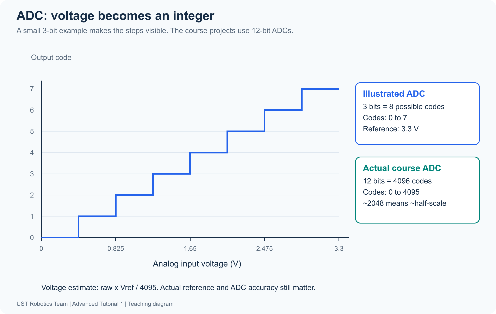
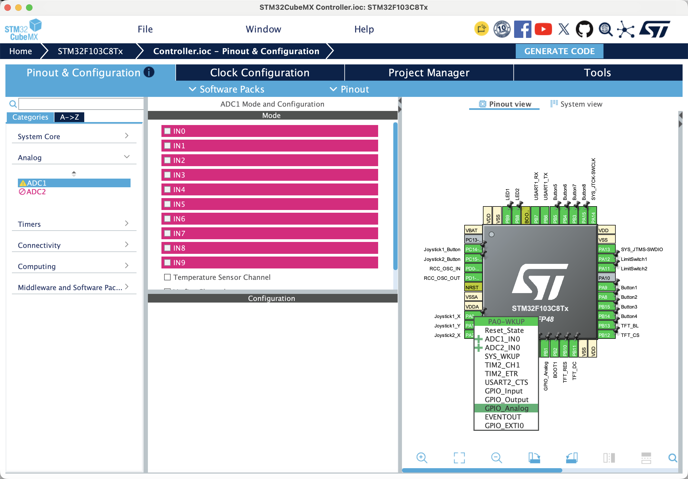
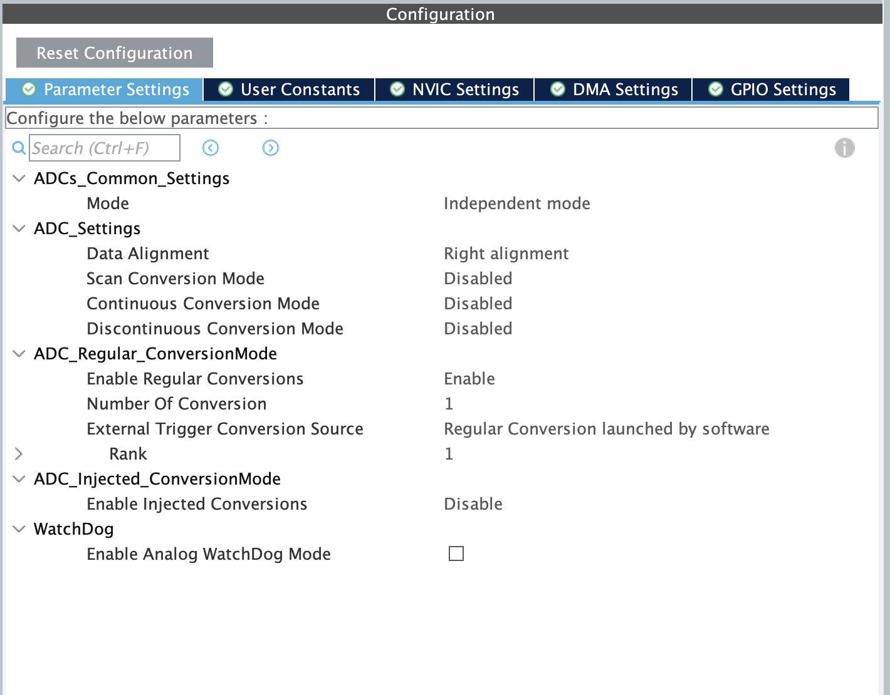
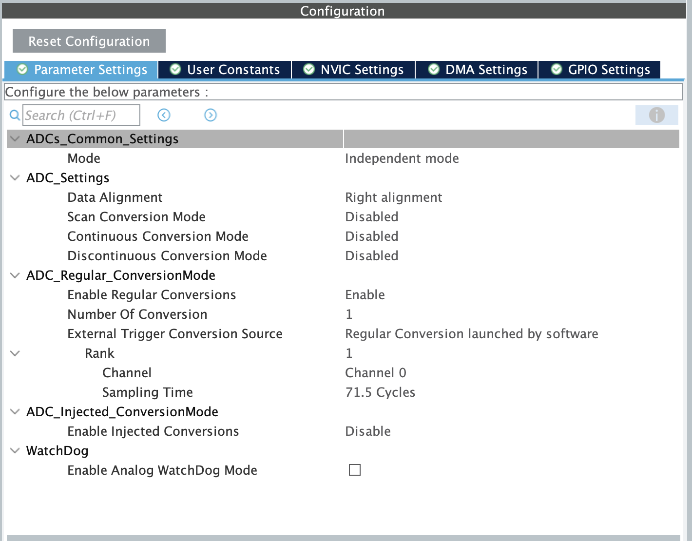
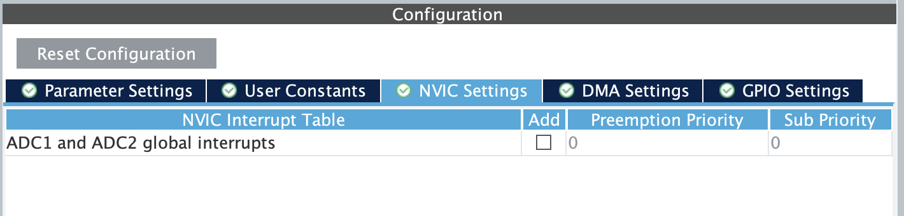
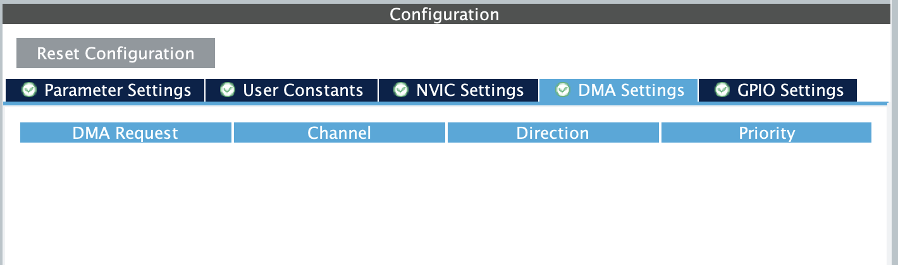
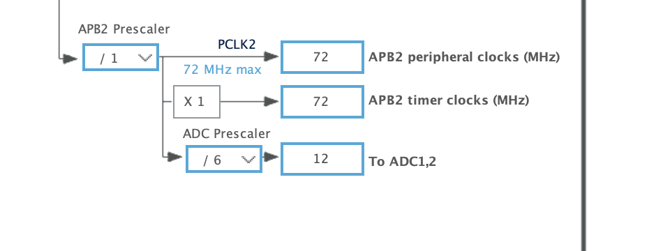
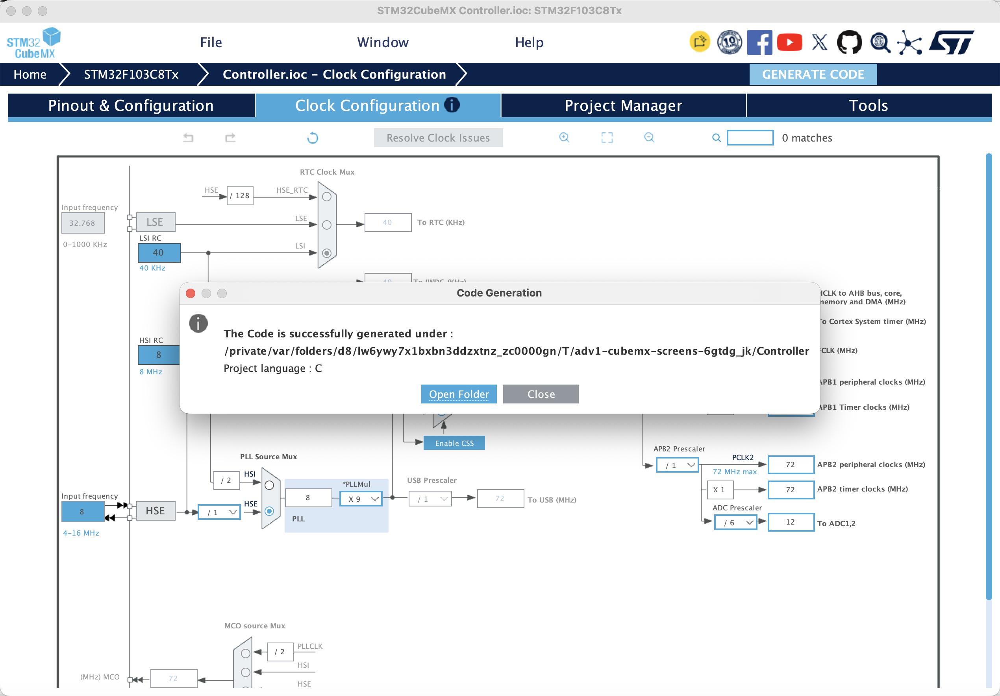

[Contents](README.md) | [Previous: Terms](00-getting-started.md) | [Next: CW1](02-joystick.md)

# 1. ADC — Analog-to-Digital Converter

A joystick contains two potentiometers. Moving it changes their output voltages.
An ADC measures a voltage and returns a number; your program gives that number
meaning as position and direction.

Use this page to understand and configure ADC1. Then follow the
[CW1 walkthrough](02-joystick.md#2-cw1a--configure-and-acquire) to implement and
test one axis before extending the same operation to four axes. You will use
one Controller project for A, B and C.

```text
Stick movement → potentiometer voltage → ADC conversion → raw code
                                                        ↓
                                             CW1B: signed position
```

**Before running:** what would a GPIO HIGH/LOW reading lose about the position?
Predict how the voltage and raw code change when you release the stick and move
it to either stop.

## 1. Sampling, resolution and voltage

**Sampling** chooses when to measure. **Quantization** assigns the measured
voltage to a numerical step.



The F103 ADC is 12-bit: `2^12 = 4096` possible codes, numbered **0–4095**.
More samples improve time coverage; more bits provide finer voltage steps.
Neither automatically removes noise or reference error.

Assuming a 3.3 V reference, a code near 2048 represents approximately 1.65 V:

```text
estimated voltage = raw / 4095 × reference voltage
ideal voltage step ≈ reference voltage / 4096
```

4096 counts the steps; 4095 is the largest code. The endpoint-scaled voltage is
an estimate. The reference is assumed, not measured. A code of zero is a valid
measurement; a failed conversion must have a separate failure indication.

**Predict:** what voltage would raw 1024 represent? Why would integer division
`raw / 4095` give an unhelpful intermediate result? Write your estimate before
using the board. If a meter is available, compare one measured signal voltage
with the code-to-voltage estimate.

## 2. Configure the ADC yourself

The Controller starter has the display, clocks, buttons and SWD prepared.
**ADC1 is deliberately disabled.** Its joystick pins start as passive analog
GPIOs; an analog GPIO setting alone does not enable an ADC channel.

Open `projects/Controller/Controller.ioc`. First assign **PA0 to ADC1_IN0**
using the pin menu in the screenshot walkthrough below. The IN0 checkbox can
be pink/unavailable while PA0 is assigned to `GPIO_Analog` in the starter.
Use these settings and explain each one to a partner:

| Setting | First-axis configuration | Meaning |
| --- | --- | --- |
| ADC input | ADC1 IN0 / PA0 | Select the physical signal |
| Scan | Disabled | One channel per request |
| Continuous conversion | Disabled | Software requests each measurement |
| Discontinuous conversion | Disabled | Not used here |
| Trigger | Software start | Your function starts the conversion |
| Alignment | Right | Read an ordinary integer code |
| Enable Regular Conversions | Enable | Make a regular conversion available |
| Regular conversions / rank | 1 / Rank 1 = Channel 0 | One result per request |
| Sampling time | 71.5 cycles | Allow the input circuit time to settle |
| ADC DMA / interrupt | Not enabled | CPU waits for and reads the result |

The F103 resolution is fixed at 12 bits. Keep the prepared clock tree and ADC
prescaler `/6`: APB2 72 MHz gives an ADC clock of 12 MHz. ADC clock frequency is
not the frequency at which the application displays measurements.

Save and **Generate Code**. Inspect `Core/Src/adc.c`: find the selected channel,
conversion mode and sampling time. Find the generated `MX_ADC1_Init()` call in
`main.c`. Configuration prepares the peripheral; it does not request a sample.
The [IOC guide](../hardware/ioc-guide.md) explains the generation checks.

### CubeMX screenshot walkthrough

These are real STM32CubeMX 6.18.1 screenshots captured while configuring a copy
of the supplied Controller starter. Follow them in your own extracted project.
The distributed starter still has ADC1 disabled; the screenshots show the
configuration you are building. The clock and display settings are retained.
Screenshots focus on the relevant panels; open an image at full size if a label
is small.

**Step 1 — Assign the first joystick pin.** Open **Pinout & Configuration**,
expand **Analog**, and select **ADC1**. If IN0 is pink and cannot be checked,
click **PA0** on the chip drawing and select **ADC1_IN0**, replacing its passive
`GPIO_Analog` assignment. IN0 should then become checked. Do not select ADC2_IN0.



**Step 2 — Select single-conversion polling settings.** In the ADC1
**Configuration** panel, open **Parameter Settings**. Keep **Independent mode**,
**Right alignment**, and **Disabled** for scan, continuous and discontinuous
conversion. If the table is cramped, drag the divider above Configuration
upwards and widen the centre panel; this only changes the window layout.



**Step 3 — Configure the regular conversion and sample window.** Expand
**ADC_Regular_ConversionMode**. Set **Enable Regular Conversions = Enable**,
**Number Of Conversion = 1**, and **External Trigger Conversion Source = Regular
Conversion launched by software**. Expand **Rank 1** and choose **Channel 0**.
Double-click the Sampling Time value if needed, open its dropdown, and select
**71.5 Cycles**. Confirm the selected value after the dropdown closes. Leave
injected conversions disabled.



**Step 4 — Keep the ADC interrupt disabled.** Open **NVIC Settings** inside the
ADC1 configuration. Leave **ADC1 and ADC2 global interrupts** unchecked. Other
existing system/UART interrupt settings belong to the starter and remain as supplied.



**Step 5 — Keep ADC DMA unconfigured.** Open **DMA Settings** inside ADC1.
The request table should be empty; do not add an ADC DMA request for this polling exercise.



**Step 6 — Check the ADC clock.** Open the top **Clock Configuration** tab.
Follow **APB2 peripheral clocks = 72 MHz** to **ADC Prescaler = /6** and confirm
**To ADC1,2 = 12 MHz**. The supplied clock tree already uses these values.
Keep the existing HSE, PLL and bus prescalers.



**Step 7 — Save, generate and inspect.** Use **File → Save Project**, then
click **GENERATE CODE** at the upper right. Wait for the success dialog.
Click **Close**, then inspect `Core/Src/adc.c`, `Core/Inc/adc.h` and the generated
`MX_ADC1_Init()` call in `main.c`. It must occur once, before `TutorialApp_Init()`.
The folder path in this screenshot is the temporary demonstration copy; your
output belongs in your own Controller folder. Keep the prepared CMake toolchain.



Configuration is now generated. Rebuild the project before implementing the
acquisition functions below. `ADC NOT READY` can still appear while
`Joystick_Start()` is a TODO; generating ADC initialization does not complete
the student acquisition code.

### What generation owns, and what you write

| File | Responsibility |
| --- | --- |
| `Controller.ioc` | Your ADC pin, clock and conversion configuration |
| Generated `Core/Src/adc.c` and `Core/Inc/adc.h` | ADC initialization and the existing `hadc1` handle |
| Generated `Core/Src/main.c` | One `MX_ADC1_Init()` before `TutorialApp_Init()` |
| `Core/Src/joystick.c` | Your startup calibration and one-channel polling operation |
| `Core/Src/student_tasks.c` | Your one/four-axis collection and normalization |
| `Core/Inc/joystick_config.h` | Axis count, measured calibration and deadband |

After generation, confirm that your independent task files are retained and that
the app/TFT initialization and update calls are still present. Use the existing
generated handle; do not define another `hadc1`, copy initialization into a task,
or add a second `MX_ADC1_Init()` call. The same checks apply when you generate
again for the remaining axes. B and C do not require changing ADC initialization.

## 3. Write one complete conversion

CW1A uses **polling**: the CPU waits for conversion completion. Implement the
functions in `Core/Src/joystick.c`; the starter does not contain a completed
acquisition function. Add `#include "adc.h"` after generating ADC1 code.

### First: calibrate once at startup

Implement the existing `Joystick_Start()` in `joystick.c`. Look up
`HAL_ADCEx_Calibration_Start()` in the bundled F103 HAL and use the existing
`hadc1`. Return `true` only if its status equals `HAL_OK`; return `false`
otherwise. **`HAL_OK` has the numeric value 0**, which is false in C, so returning
the HAL status directly from a Boolean function would reverse success.

The app already calls `Joystick_Start()` once after generated initialization.
Do not call it a second time in `main.c` or recalibrate before every conversion.
After save/build/flash/Continue, successful calibration with an unfinished
reading task changes the screen from `ADC NOT READY` to `READ NOT READY` /
`CHECK CW1A READ`. That is the next task boundary; it is not a reason to bypass
the reading error check.

### Then: complete one requested conversion

Implement the existing `Joystick_ReadChannel(uint32_t channel, uint16_t *raw)`:

- `channel` selects the input, using an `ADC_CHANNEL_*` constant.
- `raw` points to the caller's output element. Reject a null output pointer.
- The Boolean return reports success. The pointed-to value carries the code.
  A successful code of 0 is different from a failed read.

| Operation | HAL API to look up | Question |
| --- | --- | --- |
| Configure the requested input | `HAL_ADC_ConfigChannel()` | Which channel is being measured? |
| Start | `HAL_ADC_Start()` | Has conversion finished merely because it started? |
| Wait with a finite timeout | `HAL_ADC_PollForConversion()` | What happens if completion never arrives? |
| Read the completed result | `HAL_ADC_GetValue()` | When is the value usable? |
| Stop | `HAL_ADC_Stop()` | Is the ADC stopped before selecting another channel? |

For channel configuration, use an `ADC_ChannelConfTypeDef` with the requested
`Channel`, `Rank = ADC_REGULAR_RANK_1`, and
`SamplingTime = ADC_SAMPLETIME_71CYCLES_5`. Use `&hadc1` with the HAL operations.
The generated initial configuration chooses Channel 0; your function selects
the requested channel for each subsequent operation.

```text
Check output pointer → configure channel → start → wait for completion
                                                   ↓
                         publish output ← stop ← get completed result
```

Use Rank 1 and 71.5-cycle sampling when selecting a channel. Check the status
of operations that return a status. Only publish the output after the whole
operation succeeds; leave the caller's output unchanged on failure. Stop an
operation you started even when its wait fails. A short finite timeout such as
10 ms avoids an endless wait. Do not use a delay as proof of completion.

`HAL_ADC_GetValue()` returns a value, not a HAL success status. Call it only after
completion has been confirmed, store the result locally, then stop and check
the stop status. Assign `*raw` and return success only after the entire operation
succeeds. On failure, perform the required stop/cleanup and return `false`
without replacing the caller's output with a fake zero reading.

| Quantity | Value here | Meaning |
| --- | --- | --- |
| ADC clock | 12 MHz | Clock driving the ADC circuitry |
| Sampling time | 71.5 ADC clock cycles | Input acquisition window before conversion |
| Poll timeout | For example, 10 ms | Maximum wait; returns earlier when completion is detected |
| App update interval | About 100 ms, plus processing time | How often the app requests/displays a set of readings |

These are not interchangeable rates or delays. In particular, a 10 ms timeout
does not force every successful conversion to wait 10 ms.

Read the API descriptions in the bundled HAL source:
`Drivers/STM32F1xx_HAL_Driver/Src/stm32f1xx_hal_adc.c` and
`stm32f1xx_hal_adc_ex.c`. Identify the completion check and where GetValue obtains
the conversion result. Use the documentation to write your function, then explain
why each operation is needed.

Finish the [single-axis caller in CW1A](02-joystick.md#first-read-j1-x) before
expecting live data. Implementing `Joystick_ReadChannel()` alone does not
complete `CW1_ReadJoystick()`, which also starts as a TODO.

## 4. Extend the same operation to four axes

Once PA0 works, enable ADC1 IN1/IN2/IN3 on PA1/PA2/PA3 and generate again.
Keep **scan disabled, continuous disabled, and one regular conversion**.
Your function selects one channel as Rank 1, converts it, reads it and stops,
then repeats for the next channel. Enabling four input pins does not require a
four-rank scan in this exercise.

Use each PA pin's menu to replace its passive `GPIO_Analog` assignment with
ADC1_IN1, IN2 or IN3 if the mode checkbox cannot be selected. Keep the initial
Rank 1 set to Channel 0; the runtime function switches it for each requested read.

```text
Select CH0 → start → wait → read → stop → J1 X
Select CH1 → start → wait → read → stop → J1 Y
Select CH2 → start → wait → read → stop → J2 X
Select CH3 → start → wait → read → stop → J2 Y
```

These are four sequential measurements from ADC1, not four simultaneous ADCs.
Your `CW1_ReadJoystick()` assembles the readings. Change
`JOYSTICK_AXIS_COUNT` from `1U` to `4U` only after configuring and implementing
all four inputs. See [CW1A](02-joystick.md#2-cw1a--configure-and-acquire).

**Explain before moving on:** which setting selects the physical input, which
setting selects the sequence position, and which line of your C code decides
the output array slot? Why can the same Rank 1 be used for all four requests?

## 5. Calibration and transfer methods

ADC electrical self-calibration does not locate the joystick's released centre
or mechanical stops. CW1C measures those separately. Half the ADC voltage range
need not equal half the joystick's usable travel.

DMA moves peripheral results into memory automatically. The earlier four-axis
circular-DMA implementation remains in the repository's
[complete reference](https://github.com/UST-Robotics-Team/Software-Tutorial-2026-Notes/tree/main/reference/Controller). It is optional reading;
CW1A uses the polling functions you write. Do not run the reference DMA start
alongside this polling path.

References: [ST STM32F1 HAL ADC source](https://github.com/STMicroelectronics/stm32f1xx-hal-driver/blob/master/Src/stm32f1xx_hal_adc.c),
[ST AN2834: ADC accuracy](https://www.st.com/resource/en/application_note/an2834-how-to-optimize-the-adc-accuracy-in-the-stm32-microcontrollers-stmicroelectronics.pdf).
