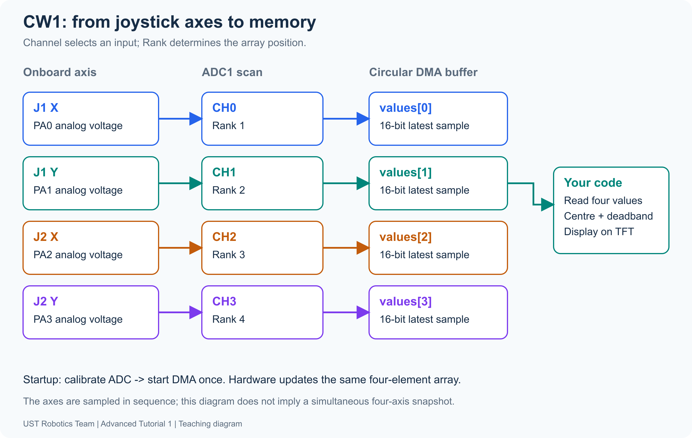
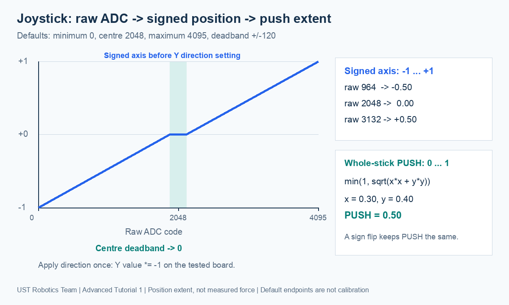

[Contents](README.md) | [Previous: ADC](01-adc.md) | [Next: IR](03-ir.md)

# 2. Joysticks — CW1 (Classwork 1)

**Goal:** read four ADC channels, implement signed normalization yourself, and
calibrate the joystick using measurements.

## 1. Read the correct axis

Each stick has two potentiometers. ADC (**Analog-to-Digital Converter**) readings
arrive through DMA (**Direct Memory Access**) in scan order:



| Axis | MCU pin | ADC1 channel | Rank | Array |
| --- | --- | --- | --- | --- |
| J1 X | PA0 | 0 | 1 | `values[0]` |
| J1 Y | PA1 | 1 | 2 | `values[1]` |
| J2 X | PA2 | 2 | 3 | `values[2]` |
| J2 Y | PA3 | 3 | 4 | `values[3]` |

The assembled Controller needs no extra sensor wires. Move one axis at a time
to verify the mapping. [IOC settings](../hardware/ioc-guide.md) explain the scan.

| Number | Range | Meaning |
| --- | --- | --- |
| Raw ADC | 0–4095 | Voltage code |
| Signed X/Y | -1 to +1 | Axis position and direction |
| PUSH | 0–1 | Whole-stick displacement magnitude, not force |

## 2. Centre, deadband and normalization

`raw / 4095.0f` puts a released stick near 0.5; we want zero.
Subtract the centre, ignore small variations, then scale the remaining travel.



Defaults: **MIN=0, CENTRE=2048, MAX=4095, deadband=120**.
The inclusive zero region is **1928–2168**.

```text
delta = raw - centre
inside -deadband ... +deadband: value = 0
positive side: value = (delta - deadband) / (maximum - centre - deadband)
negative side: value = (delta + deadband) / (centre - minimum - deadband)
clamp to -1 ... +1
```

| Example | Working | Result |
| --- | --- | --- |
| raw 3132 | delta=1084; (1084−120)/(4095−2048−120) = 964/1927 | ≈ +0.50 |
| raw 964 | delta=−1084; (−1084+120)/(2048−0−120) = −964/1928 | −0.50 |
| raw 2100 | delta=52, inside deadband | 0 |

Removing the deadband before scaling keeps the transition continuous. Use signed
subtraction and floating-point division. Both `centre-minimum` and
`maximum-centre` must exceed the deadband. Your CW1B implementation must
return zero for invalid spans before dividing.

## 3. Mechanical calibration and direction

ADC electrical self-calibration does not identify joystick end stops.
Record the raw minimum, released centre and maximum for each axis, then update
the matching `J1_X_*`, `J1_Y_*`, `J2_X_*`, `J2_Y_*` macros in
`joystick_config.h`. Keep **MIN < CENTRE < MAX**.

If the physical stop only reaches raw 3800, the default mapping gives:

```text
(3800 - 2048 - 120) / (4095 - 2048 - 120) ≈ 0.847
```

A displayed 0.85 can therefore indicate uncalibrated endpoints, not ADC failure.
Defaults are valid starting settings, not measured calibration.

The app applies Y direction **after** normalization: both Y settings start at
`-1`; X uses `+1`. Change the relevant `J1_Y_DIRECTION` /
`J2_Y_DIRECTION` if needed. Do not swap MIN/MAX or reverse Y again in the task.

## 4. Combine X and Y

```text
PUSH = min(1, sqrt(x*x + y*y))
x=0.30, y=0.40 → sqrt(0.09+0.16) = 0.50
```

PUSH is the vector length: sign changes do not affect it. Diagonal travel can
give a length above 1, so cap it at 1.

## 5. CW1A — acquire and identify the axes

Open `projects/Controller`, select the normal Debug build, and follow the
[build/flash guide](../hardware/classwork-setup.md).

The untouched starter shows `CW1 NORMALIZED` / `DO CW1 TODO`.
In `Core/Src/student_tasks.c`, complete `CW1_ReadJoystick()`: call the supplied
`Joystick_Read(values)`, then return `true`. Replace the placeholder statements;
keep the existing function signature.

Save, build, flash and run. Move only one axis at a time and identify which
array entry changes. Check all four entries against the mapping in section 1.
Record each axis's released reading and approximate endpoints for CW1C.
At this stage, signed positions and PUSH remain zero because CW1B is unfinished.

ADC setup and circular DMA are already provided. `Joystick_Read()` copies the
latest readings; do not restart the ADC in this function.

## 6. CW1B — implement normalization

Complete the existing `CW1_NormalizeAxis()` in the same file. **Write the
calculation yourself.** The student project does not contain a completed
axis-normalization helper. Section 2 gives the algorithm and worked examples.

Your function must:

1. Calculate both centre-to-endpoint spans and `raw-centre` using signed arithmetic.
2. Return `0.0f` if either span is less than or equal to `deadband`.
3. Return `0.0f` inside the inclusive centre deadband.
4. Outside it, remove the deadband and divide by the remaining span on that side.
   Use floating-point division; retain the negative sign on the negative side.
5. Clamp the final result to `[-1,1]` and return it.

Use the five parameters passed to the function; do not hard-code the default
centre, endpoints or deadband. Remove the placeholder `(void)` statements and
zero return when replacing the body. Keep the function signature.

Predict these results before testing:

| raw | minimum / centre / maximum / deadband | Expected return |
| --- | --- | --- |
| 2100 | 0 / 2048 / 4095 / 120 | 0 |
| 3132 | 0 / 2048 / 4095 / 120 | approximately +0.50 |
| 964 | 0 / 2048 / 4095 / 120 | -0.50 |
| 1000 | 200 / 1900 / 3700 / 100 | -0.50 |
| 4095 | 200 / 1900 / 3700 / 100 | +1.00 after clamping |
| 1700 | 2000 / 1900 / 3700 / 100 | 0: invalid negative span |

Save, build, flash and run again. Move each axis slowly through the centre and
both directions. Check that intermediate values change continuously and released
positions are zero inside the deadband.

The application calls your function for all four axes, applies Y direction
afterwards and calculates PUSH. You do not need to write another axis loop,
invert Y in your function or implement PUSH.

## 7. CW1C — calibrate and compare deadbands

Complete this measurement record for your own Controller:

| Axis | Smallest raw at one stop | Released centre | Largest raw at the other stop |
| --- | --- | --- | --- |
| J1 X | | | |
| J1 Y | | | |
| J2 X | | | |
| J2 Y | | | |

Move each axis to both stops several times and record the repeatable minimum
and maximum. Release it and take at least ten settled raw readings; use their
average, rounded to an integer, as the centre. Retain the centre readings to
describe idle variation.

Update the corresponding `J1_X_*`, `J1_Y_*`, `J2_X_*` and `J2_Y_*` values in
`Core/Inc/joystick_config.h`. Keep MIN < CENTRE < MAX and both spans greater
than the chosen deadband. MIN/MAX are ordered ADC values, even on a reversed Y axis.
Save, rebuild, flash and compare released, intermediate and end-stop positions.
The physical stops should now approach the normalized endpoints.

Compare `JOYSTICK_DEADBAND=60U` and `120U`, rebuilding and flashing each time.
Keep the calibration values unchanged during this comparison. Note whether each
setting covers the observed idle variation and how far you must move before
the output leaves zero. A perfectly stable centre may show zero with both settings.
Choose a setting and explain the tradeoff between idle stability and small movements.

## 8. Demonstrate and explain

```text
CW1 NORMALIZED
J1X:3132 +0.50
J1Y:2048 +0.00
J1 PUSH:0.50

J2X:2048 +0.00
J2Y:2048 +0.00
J2 PUSH:0.00
IDLE=0 FULL=1
ADC RUNNING
```

These are example values using the default settings, not a measurement target
for your calibrated Controller. Show a senior:

- **CW1A:** all four raw readings and their axis mapping.
- **CW1B:** your own normalization code, zero in the deadband, continuous signed
  positions, correct direction and PUSH within 0–1. Explain the two different spans
  and why integer division would give the wrong result.
- **CW1C:** your four-axis calibration record, the configuration changes and
  observations from both deadband settings.

Explain raw ADC versus signed position versus PUSH. Explain why raw 3800 can
produce about 0.85 before endpoint calibration, and why larger deadbands ignore
more small intentional movements.
