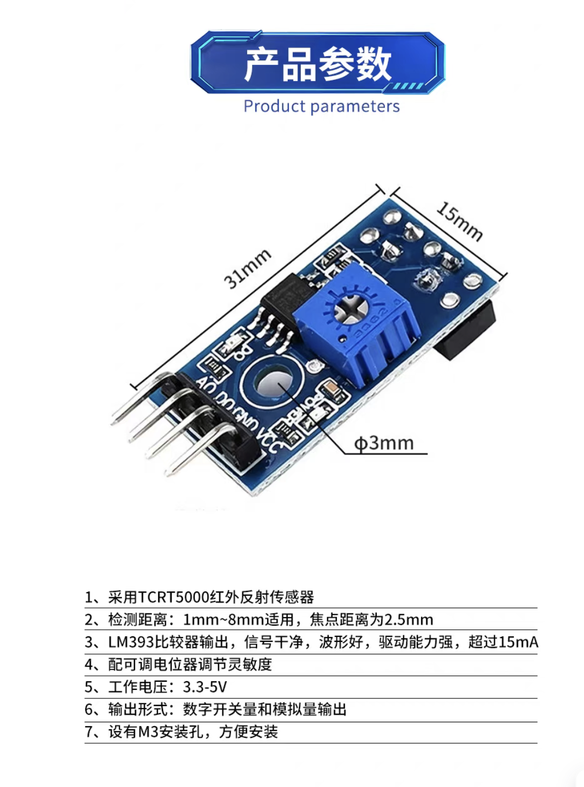
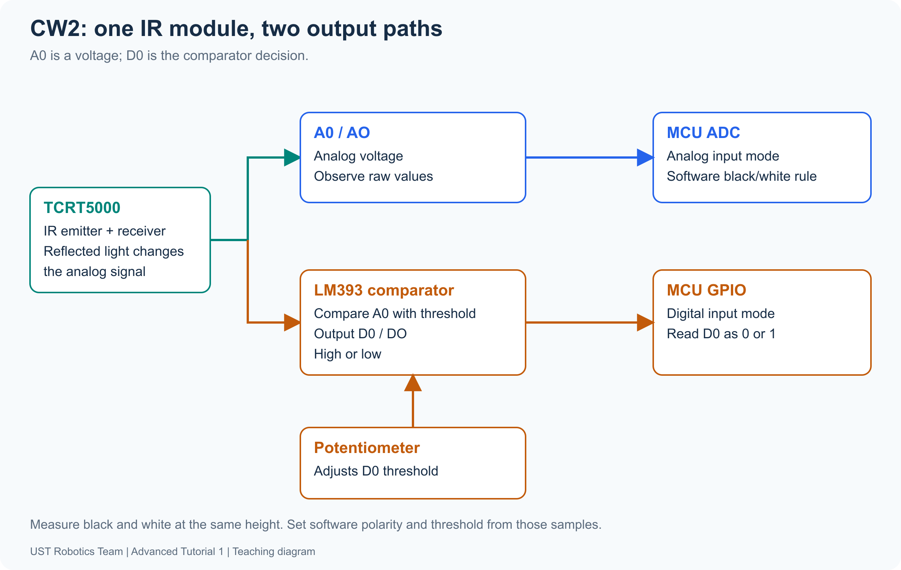
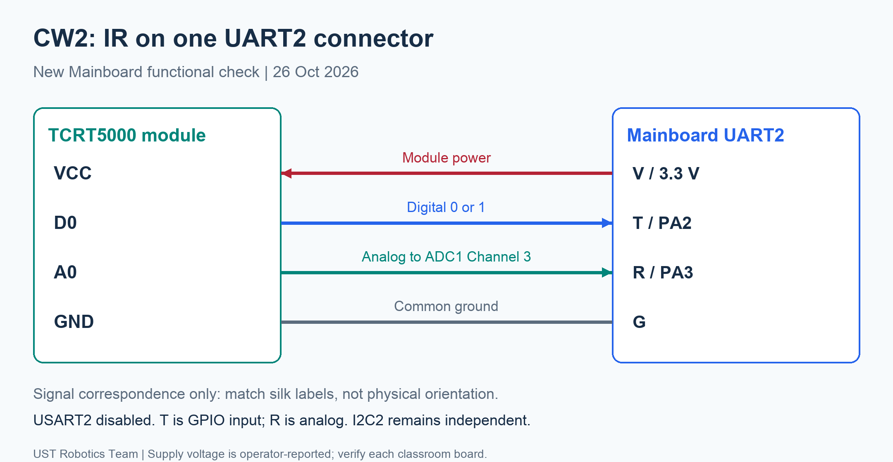

[Contents](README.md) | [Previous: CW1](02-joystick.md) | [Next: CW3](04-ultrasonic.md)

# 3. IR (Infrared) Sensor — CW2

**A: configure/read D0 → B: configure/read A0 → C: measure and classify.**
Keep the same MainBoard project for CW2, CW3 and optional TOF. The display is
provided; the digital and ADC acquisition functions are student tasks.

## 1. Two outputs from one reflective sensor

The TCRT5000 emits infrared light. A phototransistor responds to reflected light,
and the module produces a varying voltage. Material, height and angle all affect
it; brightness alone is not a unique distance measurement.

| Output | Signal | MCU operation | Decision |
| --- | --- | --- | --- |
| A0 | Varying voltage | ADC | Your measured software threshold |
| D0 | HIGH/LOW | GPIO input | Module comparator threshold |

The potentiometer changes D0's comparator threshold, not A0 directly. Predict
which output retains information about how close a reading is to a threshold.

## 2. Connect and check the starter

Power off before wiring. Match labels, not wire colours. The checked arrangement
uses the UART2-labelled header with **USART2 disabled**:

| Module | UART2 header | Function |
| --- | --- | --- |
| VCC | V | Reported 3.3 V; confirm on your board |
| D0 | T / PA2 | Digital input |
| A0 | R / PA3 | ADC1 Channel 3 |
| GND | G | Common ground |

Open `projects/MainBoard`, build Debug, flash and Continue as in
[setup](../hardware/classwork-setup.md). The untouched starter shows
`IR + ULTRASONIC`, `IR NOT READY`, `CHECK CW2 GPIO`, `US NOT READY`,
`CHECK CW3 TIMER` and an increasing RUN time. It does not supply sensor readings.
PA2 starts as a passive input, PA3 as an analog GPIO; **ADC1 is not yet enabled**.

## 3. CW2A — read D0 yourself

1. Open `MainBoard.ioc`. Set/check PA2 as **GPIO_Input, no pull** and keep
   USART2 disabled. Preserve the display, buttons, clocks and SWD.
2. Save and Generate Code. Find PA2's input mode in generated GPIO initialization.
   The connector's UART2 name does not require enabling its UART peripheral.
3. In `Core/Src/ir_sensor.c`, complete `IR_ReadDigital(uint8_t *d0)` using
   `HAL_GPIO_ReadPin()`. Write 0 or 1 only on success and return a HAL status.
4. Rebuild/flash. The screen should show `A0:---- D0:0` or `D0:1`, with
   `ADC TODO/ERROR`. A0 is still unimplemented. Move the module over black/white
   paper and adjust the potentiometer; record how D0 changes.

Explain why one digital bit can change abruptly even when reflectance changes
gradually. Do not assume that D0=1 always means BLACK.

## 4. CW2B — read A0 yourself

In CubeMX enable **ADC1 IN3 / PA3** and configure:

| Setting | Value |
| --- | --- |
| Resolution / alignment | 12-bit / right |
| Scan / continuous / discontinuous | Disabled |
| Trigger | Software start, no external edge |
| Regular conversions / Rank 1 | 1 / Channel 3 |
| ADC prescaler | PCLK2 / 4: 84 MHz / 4 = 21 MHz |
| Sampling time | 144 cycles |
| ADC DMA / interrupt | Not enabled |

Generate Code. Find `adc.c`, `adc.h` and one generated `MX_ADC1_Init()` before
`TutorialApp_Init()` in `main.c`. Do not add another initialization call.
Add `#include "adc.h"` to `ir_sensor.c` after generation.

Complete `IR_Read(IR_Sample *sample)`: use single-conversion polling for A0 and
your digital function for D0. Reuse CW1's start/wait/read/stop reasoning. Use a
finite timeout and check status; stop a started operation even after its wait
fails. Publish the complete sample only on success. A raw zero is valid data,
not an error sentinel. F405 does not use the F103 self-calibration API.

Rebuild/flash. Both A0 and D0 should respond, with `SURFACE: ?` until CW2C.
On an ADC failure A0 becomes dashes while the separately successful D0 reading
remains available. The app skips classification of a failed sample.

## 5. CW2C — choose and implement a measured threshold

Keep a small fixed height and angle. Record at least five readings per surface:

| Surface | Five A0 samples | Minimum | Maximum | D0 |
| --- | --- | --- | --- | --- |
| White | | | | |
| Black | | | | |

Choose a threshold in the gap between the ranges. Determine whether black is
higher or lower from the measurements, then set `IR_THRESHOLD` and
`IR_BLACK_IS_HIGH` in `Core/Inc/tutorial_config.h`. The supplied 2000/1 values
are starting examples. If ranges overlap, improve height/lighting and repeat.

Complete `CW2_ProcessIR()` in `Core/Src/student_tasks.c` using `sample->raw`.
Draw `SURFACE: BLACK` or `SURFACE: WHITE` on row 2. Rebuild/flash and repeat both
surfaces. Adjust the module potentiometer and compare D0 with your software label.
The software classification must use A0; its result may differ from D0.

Explain the circuit → GPIO/ADC configuration → acquisition → threshold → label
path. Show your samples and justify the threshold/polarity. This adds no marks.
Optional: add hysteresis and explain what state is retained between thresholds.

Continue in the same project to [CW3](04-ultrasonic.md). Complete earlier code
remains in the repository's `reference/MainBoard` directory; it is outside the
student archive.

Reference: [Vishay TCRT5000](https://www.vishay.com/docs/83760/tcrt5000.pdf).
