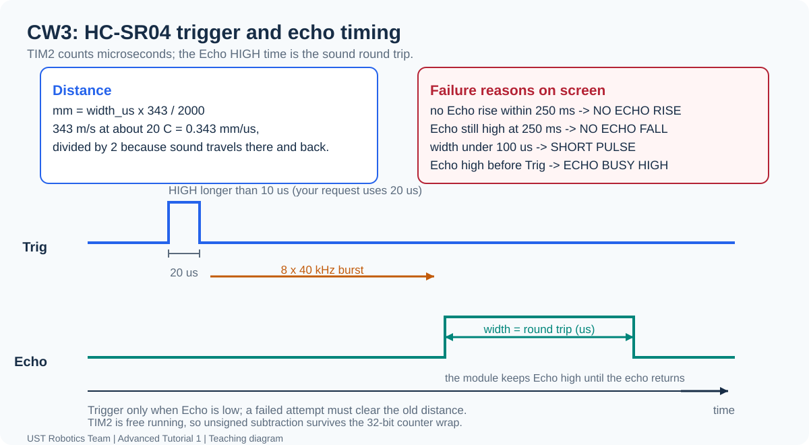
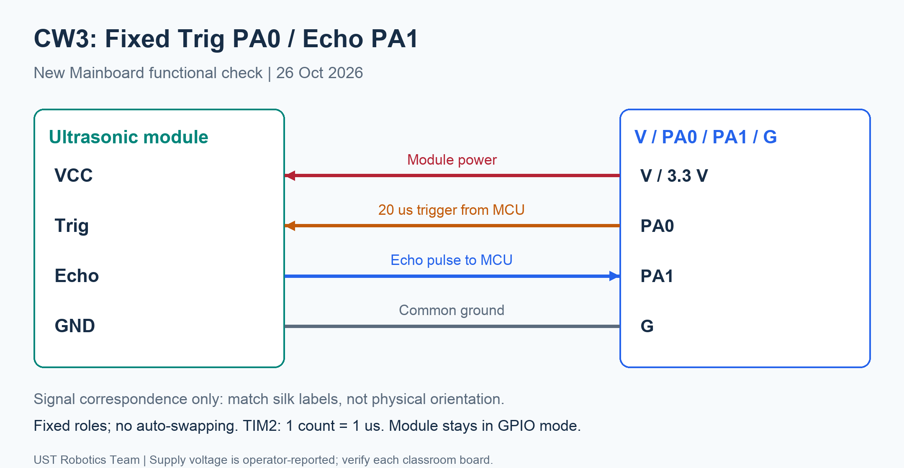

[Contents](README.md) | [Previous: CW2](03-ir.md) | [Next: I2C](05-i2c.md)

# 4. Ultrasonic Distance — CW3

**A: configure timing and trigger → B: capture Echo with timeouts → C: calculate
and verify distance.** Keep the same MainBoard project and your completed IR code.

## 1. Understand the timing before coding



Trig is an MCU output: a short HIGH pulse requests one measurement. The module
emits ultrasound and reports an Echo HIGH interval representing round-trip time.
One GPIO read only reports the current level. You need the rising and falling
timestamps to obtain a duration. The Trig pulse stays 20 us while Echo width
changes with distance.

Predict: if a valid Echo interval doubles, what happens to distance? Why does
`HAL_Delay(20)` not make a 20 us trigger? It takes milliseconds.

Power off before wiring and confirm the module's tested GPIO mode:

| Module | Mainboard header | Role |
| --- | --- | --- |
| VCC | V | Reported 3.3 V; confirm on your board |
| Trig | PA0 | Output |
| Echo | PA1 | Input, no pull |
| GND | G | Common ground |



IR stays on UART2. No automatic pin swapping or mode probing is performed.

## 2. CW3A — configure the stopwatch and trigger

The starter leaves TIM2 disabled and PA0/PA1 passive. In `MainBoard.ioc` set:

| Setting | Value | Reason |
| --- | --- | --- |
| PA0 | GPIO output push-pull, idle LOW, no pull | Trig request |
| PA1 | GPIO input, no pull | Echo result |
| TIM2 clock | Internal clock | Free-running stopwatch |
| Counter mode | Up |
| Prescaler | 83 | 84 MHz / (83+1) = 1 MHz |
| Counter period | 4294967295 (`0xFFFFFFFF`) | Full 32-bit range |
| Clock division | DIV1 |
| TIM2 interrupts / DMA | Not enabled | Poll GPIO and read timestamps |

TIM2's clock is 84 MHz with the prepared APB1 setup, although PCLK1 is 42 MHz.
Calculate the counter tick period. Save and Generate Code. Verify one generated
`MX_TIM2_Init()` call in `main.c` and the settings in `tim.c`. Do not initialize
TIM2/GPIO again in an application file.

Add `#include "tim.h"` to `Core/Src/ultrasonic_gpio_port.c`. Complete:

- `Ultrasonic_Start()`: start the generated base timer with HAL and return status.
  The app calls it once after generated initialization.
- `Ultrasonic_Micros()`: return the counter using the HAL counter macro.
- `Ultrasonic_Trigger(high)`: drive PA0 with HAL GPIO.

In `Core/Src/ultrasonic.c`, implement `Ultrasonic_DelayUs(duration)` using unsigned
counter differences. Also set a finite `HAL_GetTick()` watchdog so a stopped
microsecond counter cannot trap the program. For the 2/20 us delays, a 2 ms
watchdog is sufficient; it is a failure limit, not the intended pulse length.
Return a HAL status.

After a successful timer start, the app changes from `US NOT READY` /
`CHECK CW3 TIMER` to `DO CW3 TODO`. This does not yet prove correct frequency;
check the clock calculation and observe that the counter advances.

## 3. CW3B — capture the two edges yourself

Complete `Ultrasonic_Echo()` in the port file using the PA1 GPIO input.
Then implement `Ultrasonic_WaitEdges(transaction_start, rise, fall)` in
`ultrasonic.c`. No complete waiting loop is supplied in the starter.

Your function must wait for HIGH, save its timestamp, then wait for LOW and save
that timestamp. Both waits share **one 250000 us deadline**, measured from the
end of Trig. Check timeout before accepting an edge, including on the iteration
that sees it. Use unsigned elapsed-time arithmetic so timer wrap is handled.
Also bound the attempt using `HAL_GetTick()` if the counter stalls.

Return a HAL failure and set `g_ultrasonic.reason` to `US_NO_RISE` or `US_NO_FALL`
when appropriate. Do not restart a fresh 250 ms limit at the rising edge or use
loop counts as elapsed time. Missing edges must not produce a valid distance.

## 4. CW3C — assemble and calculate one transaction

Complete `CW3_MeasureUltrasonic()` in `Core/Src/student_tasks.c`:

```text
Begin / check idle → Trig HIGH for 20 us → Trig LOW
                 → shared-deadline edge capture
                 → unsigned fall - rise → distance conversion → Complete
```

Use the supplied `Ultrasonic_Begin()` and `Ultrasonic_Complete()` for diagnostics,
output clearing and plausibility checks. Begin also uses your 2 us delay.
Check every operation that returns status, including trigger delay and edge waits.
Keep Trig LOW during the response and on every failure path.

Derive the conversion using sound speed 343 m/s near 20 C and the round trip.
For example, rise=5000 us and fall=6170 us give width=1170 us, which corresponds
to about 201 mm after rounding. Explain why division by two is needed, then write
your expression using `ULTRASONIC_MM_NUMERATOR=343` and
`ULTRASONIC_MM_DENOMINATOR=2000`. Use a wide enough unsigned intermediate.
The provided Complete helper does not correct a plausible but incorrect formula.

Return false while unfinished. Once implemented, return true with the outcome
in `*status`, including failure. On success publish `*distance_mm`; on failure
clear it. Do not confuse boolean true with HAL_OK (which is zero).
See the [file/task map](../projects/MainBoard/cw3-task-guide.md).

## 5. Measure, fail and recover

Rebuild/flash in the same Debug project. Compare a broad flat target at three
positions, starting around 20-50 cm:

| Ruler (mm) | Echo width (us) | Display (mm) | Difference |
| --- | --- | --- | --- |
| | | | |
| | | | |
| | | | |

The app supplies display formatting and the NEAR label from your valid distance.
A0/D0 should keep updating on the same screen. An ultrasonic failure shows dashes
and its reason; it must not leave an old distance looking current.

For a controlled software test, omit the Trig pulse with Echo initially LOW,
keeping timeout handling active. Expect `NO ECHO RISE` within the shared limit.
Restore the trigger, rebuild/flash and show recovery. Removing the target may
reveal another reflector; unplugging Echo can float, so neither guarantees a
specific error. Power off before changing wires.

Explain your IOC clock calculation, trigger code, both edge waits, timeout logic
and one distance calculation. Show ruler comparisons and failure/recovery.
This adds no marks. Soft/angled targets, temperature and the near blind zone
can affect readings independently of your arithmetic.

The earlier complete implementation is preserved separately in the repository
at `reference/MainBoard`. Continue to [I2C](05-i2c.md), then optional TOF.
