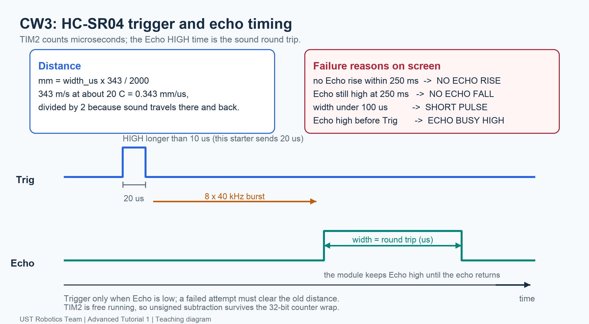
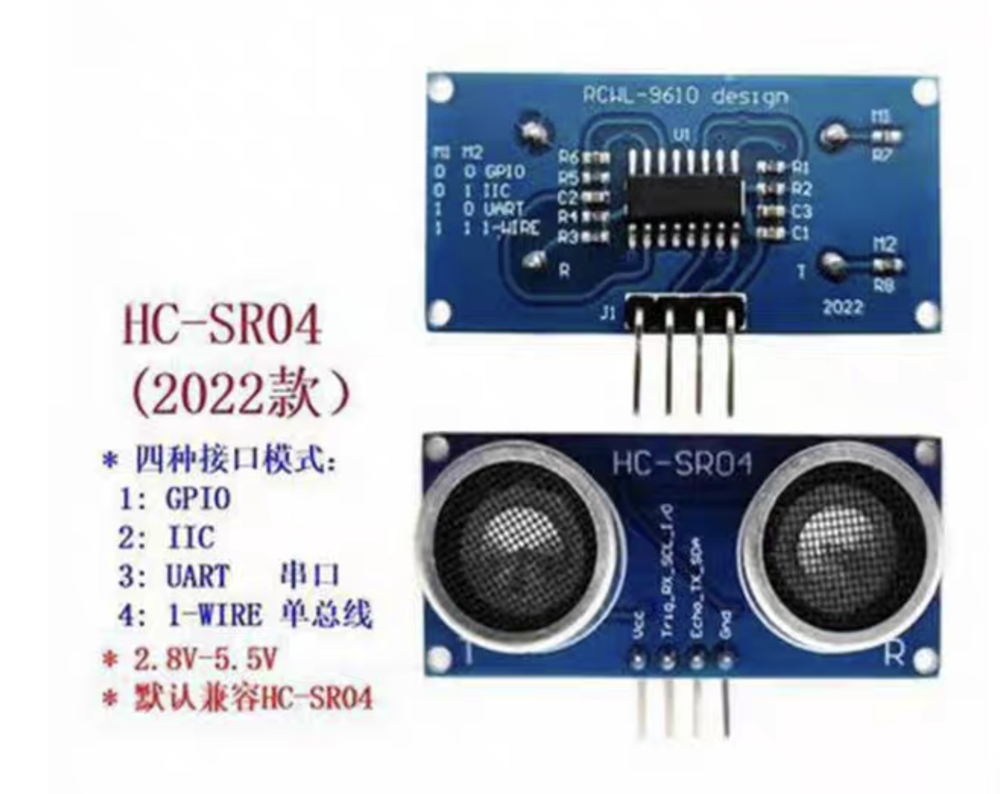

[Contents](README.md) | [Previous: IR](03-ir.md) | [Next: I2C](05-i2c.md)

# 4. Ultrasonic Distance — CW3

**Goal:** use GPIO (**General-Purpose Input/Output**) and a timer to measure
distance. Echo's **HIGH duration**, not its current level, carries the answer.

## 1. Trigger and Echo do different jobs

The STM32 uses **two GPIO pins**: an **output** connected to the module's
**Trig** input, and an **input** connected to its **Echo** output.
Trig requests a measurement; Echo reports its timing result.



| Signal | STM32 pin mode | Direction and job |
| --- | --- | --- |
| Trig | GPIO output | STM32 drives LOW/HIGH to request a measurement |
| Echo | GPIO input | STM32 reads the module's result pulse |

**Follow one measurement:**

1. **Start idle:** keep Trig LOW and check that Echo is LOW. An already-HIGH
   Echo means the starter should not issue another trigger yet.
2. **Request:** drive Trig HIGH for **20 us**, then return it LOW. This short
   electrical pulse tells the module to take one measurement. Do not keep
   Trig HIGH while waiting for the result.
3. **Send and listen:** the module generates a short **40 kHz ultrasonic burst**
   and listens for sound reflected by the target. Its internal circuit drives
   the transducer; the STM32 does not generate the sound waveform on Trig.
4. **Report:** the module outputs a HIGH pulse on Echo. Its **duration represents
   the sound's round-trip travel time**. Echo is a digital result signal, not
   the microphone's raw waveform or a distance number sent as bytes.
5. **Measure:** the STM32 records when Echo changes LOW → HIGH and HIGH → LOW.
   Subtract the timestamps to obtain the pulse width, then calculate distance.

For a valid measurement, a shorter Echo pulse means a nearer target and a longer
one means a farther target. **Trig stays the same 20 us; Echo width changes.**
One HIGH/LOW read only tells you whether the pulse is currently active.

The free-running **1 MHz timer** advances once per microsecond, like a stopwatch.
Earlier PWM (**Pulse Width Modulation**) used timers to generate an output;
here GPIO detects the edges and the timer supplies timestamps. Missing edges
must time out rather than be treated as zero distance.

## 2. Calculate one distance

```text
Echo rise = 5000 us; fall = 6170 us
width = 6170 - 5000 = 1170 us
343 m/s = 0.343 mm/us
distance = 1170 × 0.343 / 2 = 200.655 mm ≈ 201 mm
```

Divide by two for the trip **to the target and back**. The starter rounds using:

```c
mm = (width_us * ULTRASONIC_MM_NUMERATOR
      + ULTRASONIC_MM_DENOMINATOR / 2U) / ULTRASONIC_MM_DENOMINATOR;
```

The constants are 343 and 2000. Twice the valid Echo width gives twice the
distance; Trig width stays fixed. `HAL_Delay()` takes milliseconds, not microseconds.

## 3. Follow the states

| State | Action | Failure |
| --- | --- | --- |
| Ready | Trig LOW; check Echo LOW | Echo already HIGH |
| Request | Trig HIGH for 20 us, then LOW | Wrong pulse timing |
| Wait for rise | Save LOW → HIGH timestamp | No rise |
| Wait for fall | Save HIGH → LOW timestamp | No fall |
| Calculate | Subtract timestamps; convert | Width below 100 us |

Both waits share **one 250 ms deadline**, starting after Trig goes LOW.
Check it every iteration, including the iteration seeing an edge.
Restarting the timeout at the rising edge would increase the total waiting limit.

Use unsigned `fall-rise` and elapsed-time subtraction: it handles counter wrap
within this bounded interval. Counting loop iterations is not a stable timebase.
A missing reply is not zero distance; clear the old reading and show an error.

## 4. Implement CW3 with supplied helpers

Keep the same Mainboard Debug project and your completed CW2 function. Wiring is
fixed and the I2C2 connector remains independent:

| Module pin | Mainboard header | Function |
| --- | --- | --- |
| VCC | V, reported 3.3 V | Module power |
| Trig | PA0 | Output, idle LOW |
| Echo | PA1 | Digital input |
| GND | G | Common ground |


Confirm supply/labels and power off before wiring. Use the module's tested GPIO
mode. IR remains on UART2. See [setup](../hardware/classwork-setup.md).

### Start with the unfinished task

The untouched starter shows `ULTRASONIC CW3`, `DO CW3 TODO` and distance dashes.
It does not trigger the module or display a ready-made distance. Work through
A/B/C below, then test your code on the flat target. IR remains available for CW2.

### Fill the measurement's key steps

Open `CW3_MeasureUltrasonic()` in `Core/Src/student_tasks.c`. It contains a
prepared function with setup, bounded waits and status guards already written.
Fill **only A/B/C**, then remove the early `return false`:

| TODO | Your code | Purpose |
| --- | --- | --- |
| A | Trig HIGH → delay `ULTRASONIC_TRIGGER_US` → Trig LOW | Request one measurement |
| B | `width_us = fall_us - rise_us` using unsigned values | Measure the Echo HIGH interval |
| C | Convert `width_us` to rounded millimetres | Apply sound speed and divide by two |

Use `Ultrasonic_Trigger()` and `Ultrasonic_DelayUs()` for A.
The Trigger argument is `true` for HIGH and `false` for LOW; DelayUs takes microseconds. The supplied
`Ultrasonic_WaitEdges()` fills the rising/falling timestamps with one shared
250 ms deadline. Keep its status guards; you do not implement the waiting loops
or maintain diagnostic counters. See the [task guide](../projects/MainBoard/cw3-task-guide.md).

The template's early `return false` keeps `DO CW3 TODO` visible while you edit. After A/B/C
are complete, remove that early line and keep the prepared `return true` lines.
Save → Build Debug → Run and Debug → Continue. Expect `ULTRASONIC CW3`.

The app now uses your result **including errors**. `SHORT PULSE` can indicate an unfinished width calculation;
`BAD CALCULATION` indicates an unusable width/distance result. A plausible but
incorrect formula still needs your ruler comparison to reveal it.

## 5. Demonstrate distance, failure and recovery

```text
ULTRASONIC CW3
DIST:  201 mm
ECHO:  1170 us
NEAR: NO
```

Start with a broad flat target 20–50 cm away; compare three positions:

| Ruler (mm) | Display (mm) | Difference (mm) |
| --- | --- | --- |
| _____ | _____ | _____ |
| _____ | _____ | _____ |
| _____ | _____ | _____ |

For a controlled **software** failure, temporarily omit the Trig pulse in your
completed TODO A while leaving the status guards intact. With Echo initially
LOW, expect `NO ECHO RISE` and `DIST: -----`. Restore A, rebuild/flash and show
recovery. IR should still update in both cases. This checks the software path;
it does not simulate every electrical fault.

A removed target may reveal another reflector; an unplugged Echo can float.
Neither guarantees one error. Power off before changing connections.

Soft materials absorb sound; angled surfaces can reflect it away; other objects
in the beam can be detected. Air temperature changes sound speed, while this
calculation assumes 343 m/s near 20 C. The module has a roughly 2–3 cm blind zone.
These effects are not fixed by changing arithmetic.

<details>
<summary>Module mode reference</summary>



Use HC-SR04-compatible GPIO mode, with M1/M2 selector resistors unfitted.
A senior checks the module and [physical connections](../hardware/pin-mapping.md).
The roles stay fixed; the program does not probe or swap signal pins.

</details>

Core classworks are complete. Continue to the [I2C explanation](05-i2c.md), then
[TOF comparison](06-optional-tof.md), if interested.
