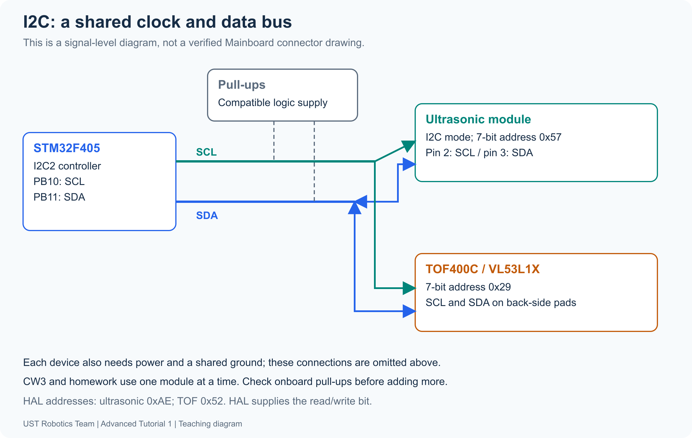

[Contents](README.md) | [Previous: CW3](04-ultrasonic.md) | [Next: optional TOF](06-optional-tof.md)

# 5. I2C — Inter-Integrated Circuit

I2C transfers addressed data over SDA (Serial Data) and SCL (Serial Clock).
The STM32 acts as the controller: it chooses a target, direction and transaction.
The sensor defines the meaning of commands, registers and returned bytes.
This lesson supports the [optional TOF exercise](06-optional-tof.md).



## 1. Trace a register read

A device address selects a sensor. A register address selects a field inside it.
These are distinct from the value returned in that field.

| Item | VL53L1X example | Meaning |
| --- | --- | --- |
| 7-bit device address | 0x29 | Which sensor |
| F4 HAL device argument | 0x52 | Address shifted left once |
| Register address | 0x0096 | Distance-result field after sensor initialization |
| Register address width | 16 bits | Two bytes select the field |
| Data length | 2 bytes for this field | Amount returned |
| Example data | 01 2C | Encoded value, not text |

The F4 HAL supplies the read/write bit. Pass **0x52 for both reads and writes**;
write/read address bytes on the bus become 0x52/0x53. Do not shift twice.

A register read selects the device for writing, sends the register-address bytes,
then uses a repeated START to select the same device for reading. It receives
data and ends with STOP. ACK/NACK indicates acknowledgement; the controller's
NACK on the final received byte is normal termination.

Ordinary data stays stable while SCL is HIGH. START is SDA falling while SCL is
HIGH, and STOP is SDA rising while SCL is HIGH. Open-drain outputs pull LOW or
release the line; compatible pull-ups restore HIGH. Confirm actual pull-up
voltage and sensor supply rather than assuming them from a connector name.

## 2. Decide what each layer does

| Layer | Responsibility in this exercise |
| --- | --- |
| IOC / generated initialization | Configure I2C2 clocks, AF pins, addressing and bus speed |
| HAL / I2C peripheral | Transfer address/data and generate bus signalling |
| Your platform functions | Supply device, register, address width, buffer, length and timeout |
| Provided sensor configuration library | Define sensor registers and initialize the ranging engine |
| Your measurement function | Wait for ready, obtain status/distance, clear event and evaluate validity |
| Provided app | Display a valid result or an error; retry initialization after I/O failure |

In the classroom starter, I2C2 is initially disabled and the bus-transfer functions
are unfinished. You configure/generate the bus and implement the transfer calls;
no completed TOF bus or measurement function runs behind the screen.

## 3. Look up the operations, then implement them

| API | Purpose |
| --- | --- |
| `HAL_I2C_IsDeviceReady()` | Check that the selected address acknowledges |
| `HAL_I2C_Mem_Read()` | Send a register address and receive its data |
| `HAL_I2C_Mem_Write()` | Send a register address and write data |

For this sensor, use `I2C_MEMADD_SIZE_16BIT`. Address width and data length are
independent. Initialization of I2C2 does not initialize the sensor's ranging
engine, and declaring a sample variable does not refresh it.

A byte has eight bits. Predict the integer represented by two bytes 01 2C when
the first byte is the high byte. Predict what reversing them would produce.
Then implement the combination yourself in `VL53L1_RdWord()`; the sensor's register
definition supplies the unit. I2C itself does not label a value as millimetres.

Keep the provided first-error latch. After one transfer fails, later transfers
must not conceal the failure. Use finite transaction/readiness timeouts.

## 4. Separate communication from measurement validity

```text
Address response → sensor initialized → new measurement ready
                 → result/status read → event cleared → validity checked
```

An ACK proves address response. HAL_OK proves a HAL operation completed.
Neither guarantees that the register, byte order, target or optical range is
correct. For the provided profile, publish a distance only when communication
succeeds and the returned sample is valid. An invalid sample is not zero distance
and must not be treated as a safe/far obstacle.

## 5. Generate without overwriting your work

Save IOC and Generate Code after peripheral changes; edit configuration in IOC,
not by changing generated initialization bodies. CubeMX creates `i2c.c`/`i2c.h`,
`hi2c2` and one `MX_I2C2_Init()` call. The handle describes the bus, not a reading.

Your tasks stay in independent `vl53l1_platform.c`, `tof_sensor.c` and
`student_tasks.c`. Keep custom includes/app calls within USER CODE regions in
`main.c`, and keep Keep User Code enabled. Do not add a second peripheral init
call in the user region. See the [IOC guide](../hardware/ioc-guide.md).

After only application changes, save/build/flash. After IOC changes,
save/generate/build/flash. Continue in the same MainBoard project through the
[TOF steps](06-optional-tof.md); IR and ultrasonic stay available.

References: [NXP I2C specification](https://www.nxp.com/docs/en/user-guide/UM10204.pdf),
[ST STM32F4 HAL I2C source](https://github.com/STMicroelectronics/stm32f4xx-hal-driver/blob/master/Src/stm32f4xx_hal_i2c.c).
