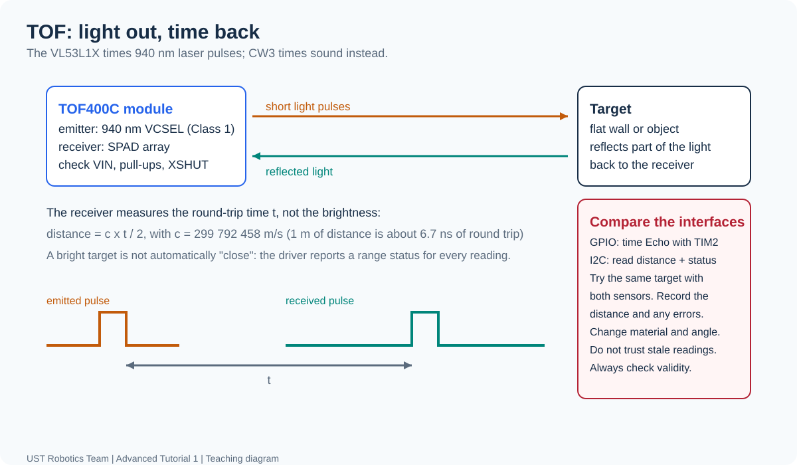
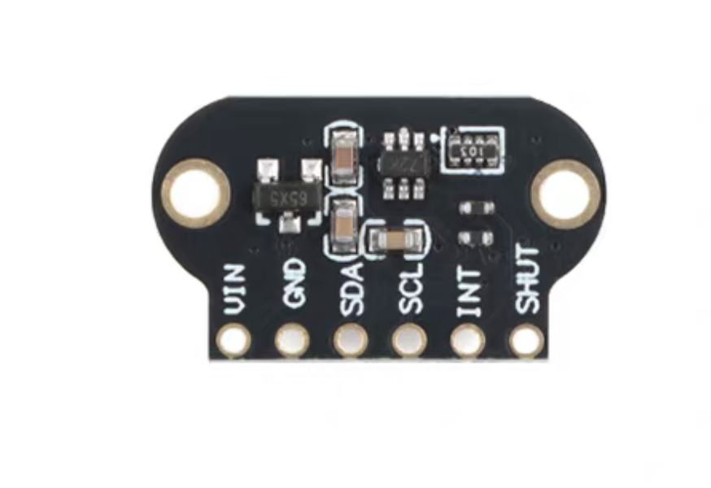

[Contents](README.md) | [Previous: I2C](05-i2c.md) | [Next: troubleshooting](07-troubleshooting.md)

# Optional after-class module: TOF400C laser distance sensor

**Optional / self-study** · **Board:** RDC Mainboard
· **Interface:** I2C

Nothing in this chapter is marked or submitted. It is here for students who are
curious, and it is the place where the [I2C lesson](05-i2c.md) is applied now that
CW3 uses the ultrasonic sensor in its GPIO mode. Work through it at your own pace;
the lecturer can answer questions at the next session.

## What this sensor actually measures

The TOF400C carries a **VL53L1X**: a 940 nm infrared VCSEL (Class 1, eye-safe,
invisible), a SPAD receiver array and the timing logic on one die. It emits very
short light pulses and measures how long the reflected light takes to come back:

```text
distance = c x t / 2      c = 299 792 458 m/s
```

The factor 2 is the round trip, exactly as in CW3 - but light travels about
10^6 times faster than sound, so "1 metre away" is only about 6.7 ns of flight
time. That is why the sensor, not the MCU, does the timing.

| Property | CW3 ultrasonic | TOF400C / VL53L1X |
| --- | --- | --- |
| Signal to target | Sound, about 343 m/s near 20 C | Infrared light, about 299,792,458 m/s in vacuum; similar order in air |
| Round trip at 1 m | About 5.83 ms | About 6.7 ns |
| STM32 obtains result | GPIO (General-Purpose Input/Output) edges + TIM2 timestamps | I2C (Inter-Integrated Circuit) result/status bytes |
| Measurement timing | Module reports Echo width; your task times it | Sensor performs optical timing internally |
| Unusable result | Busy Echo, missing edge, short pulse | Communication failure or invalid range status |
| Display on failure | Clear distance; show reason | Clear distance; show invalid/error |

A 1 us timer can time the ultrasonic pulse but cannot resolve a 6.7 ns optical
round trip. The optical sensor measures it and reports a processed result.
I2C/GPIO are these modules' interfaces, not what makes sensing optical/acoustic;
another ultrasonic module could report over I2C.



## 2. Why results differ

| Condition | What to consider |
| --- | --- |
| Soft or angled target | Sound may be absorbed or reflected away |
| Another object within the beam | Ultrasonic may detect that reflector |
| Air temperature changes | Sound speed differs from the fixed 343 m/s assumption |
| Weak optical return / strong ambient infrared | TOF usable range can decrease |
| Glass or mirror | Light may transmit or redirect, changing the surface measured |

Optical TOF measures travel time; CW2 IR reflectance does not provide a unique
distance from brightness. Neither ranging sensor always succeeds where the
other fails. The VL53L1X's specified maximum is up to 4 m under suitable conditions,
not a guaranteed classroom range. Start with a broad flat target a few tens of
centimetres away.


## Wiring — I2C2 connector, module checks pending



With the pictured back facing you and pads at the bottom, the module pads are
VIN, GND, SDA, SCL, INT, SHUT. Identify the actual module labels before wiring.

| Module pad | Candidate firmware setting | New-board physical connection |
| --- | --- | --- |
| VIN | Supply compatible with the actual breakout | Header/voltage TBD |
| GND | Common ground | I2C2 G |
| SDA | PB11 / I2C2 SDA | I2C2 D |
| SCL | PB10 / I2C2 SCL | I2C2 C |
| INT | Unused; the example polls | Leave unconnected after checking the module |
| SHUT | Must be at the breakout's documented high level | Pull-up/high supply point TBD |

Do not use the old hw2 PB10_1 numbers, +5 V pin, or TFT J1 pin 2 as new-board
facts. The old TOF wiring illustration is historical and is not a current
connection plan. Complete the [wiring-status table](../hardware/pin-mapping.md).
Check the actual breakout regulator, VIN range, I2C pull-ups/voltage and XSHUT
handling; successful old-board operation does not verify this PCB or module batch.

After these checks and any pin/peripheral changes, set `TOF_WIRING_CONFIRMED=1`,
build Debug and flash the same Mainboard program. Enabling the flag adds TOF
to rows 8 and 9 beneath IR and ultrasonic. Its default zero does not initialize
or access the TOF sensor, and leaves the normal two-sensor screen in place. I2C2 itself is already
restored at 100 kHz. Use separate labelled wires after checking the module and
power. IR, ultrasonic and TOF use distinct signal pairs on this revision.

## What you are given

The starter includes a bounded C driver adapted from an ST ULD-based source and
an STM32F4 HAL platform layer. The driver source, licence and origin are included
in the kit. It is a course-specific subset, not an unmodified full ST ULD release.
You do not need to find another library, port Arduino code or invent the
initialization register table.

The supplied API is:

```c
HAL_StatusTypeDef TOF_Init(void);
HAL_StatusTypeDef TOF_Read(TOF_Sample *sample);
```

`TOF_Sample` contains `distance_mm`, `range_status` and `valid`. The prepared
application calls `TOF_Init()` at startup and retries failed initialization at
two-second intervals. When the wiring flag is enabled, it also reads and displays TOF results below
the two classroom sensors. Explain the validity checks before modifying it.

## The I2C conversation behind the driver

You do not have to write this, but reading it is the point of this optional
module: it is a real I2C sensor, from the bus up.

| Item | Value in this kit |
| --- | --- |
| 7-bit address | `0x29`, passed to the driver as `0x52` |
| Register addresses | 16-bit, big-endian multi-byte values |
| Register transfers | `HAL_I2C_Mem_Read/Write(..., I2C_MEMADD_SIZE_16BIT, ...)` |
| Startup order | address probe, boot state, chip ID `0xEACC`, configuration, start ranging |
| Each measurement | wait for data ready, read range status, read distance, clear the sensor event |

```text
Address probe → wait for boot → verify chip ID → initialize/configure
             → start ranging

Wait for ready → read range status → read distance → clear sensor event
              → repeat
```


The profile uses long distance mode, a 50 ms timing budget and a 100 ms
intermeasurement setting. Boot/ready polls have 500 ms limits and I2C transactions
have 25 ms limits. Clearing the sensor's measurement event is still required
when using polling; it is not the same as handling a Cortex-M interrupt.

The files to read are `Core/Src/vl53l1_platform.c` (the thin I2C layer),
`Core/Src/tof_sensor.c` (the bounded startup/read sequence) and
`Drivers/VL53L1X/vl53l1x_subset.c` (the register table). Watch how every wait is
bounded and how the first I/O error is kept instead of being overwritten.

## Try it yourself

1. Finish the wiring checks above with a lecturer, enable the TOF wiring flag,
   then build Debug and flash the same Mainboard program. IR and ultrasonic
   remain on the screen; TOF uses rows 8 and 9.
2. Read `DrawOptionalTOF()` in `tutorial_app.c`. It shows a distance only when
   communication succeeds **and** `sample.valid` is true. `HAL_OK` alone is not
   enough. An unusable result shows dashes and `R:` followed by the range status.
3. Compare ultrasonic and laser readings on the same target, in the same program,
   at several distances. Note where they disagree and why.
4. Test difficult targets: black cloth, a hand, a glass pane, a mirror, a wall at
   an angle. Watch `range_status` and `valid`, not just the millimetres.
5. Optional extension: add a distance alarm of your choice. An invalid result must
   show UNKNOWN/ERROR rather than being treated as "safe" or "far away".
6. Optional deeper dive: read one register by hand with `HAL_I2C_Mem_Read()` and
   compare it with what the driver reports. Try a different timing budget with
   `VL53L1X_SetTimingBudgetInMs()` and measure how the update rate changes.

Fill this in for your own notes if you like - there is nothing to hand in:

| Ruler distance (mm) | Five readings (mm) | Range status / validity | Conditions |
| --- | --- | --- | --- |
| | | | |
| | | | |
| | | | |

Questions worth answering for yourself:

- Why does the same wall give a slightly different number from the ultrasonic
  sensor, and which one would you trust for a robot bumper?
- Why can a mirror or a glass window confuse a laser rangefinder but not an
  ultrasonic one?
- Why is `HAL_OK` not enough to trust a distance?

## Additional screen rows

```text
TOF (OPTIONAL)
TOF:  300 mm
```

For this starter, normalized range status `0` with a nonzero distance is valid.
Other statuses are retained for diagnosis. On an IO error, the distance is cleared
and the application attempts reinitialization later. Avoid modifying the core
register table to fix a wiring problem.

"4 metres" is the advertised maximum under suitable conditions, not a guaranteed
classroom result. Start with a flat target a few tens of centimetres away.

References: [ST VL53L1X datasheet](https://www.st.com/resource/en/datasheet/vl53l1x.pdf),
[ULD user manual](https://www.st.com/resource/en/user_manual/um2510-a-guide-to-using-the-vl53l1x-ultra-lite-driver-stmicroelectronics.pdf),
and [ST ULD package description](https://www.st.com/en/embedded-software/stsw-img009.html).
