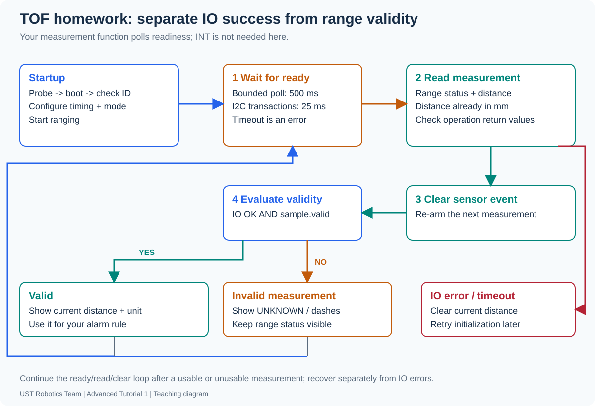

[Contents](README.md) | [Previous: I2C](05-i2c.md) | [Next: troubleshooting](07-troubleshooting.md)

# Optional after-class module: TOF400C / VL53L1X

**A: configure I2C and probe → B: implement register transfers/byte decoding →
C: read a valid ranging result.** Keep the same MainBoard project and completed
IR/ultrasonic tasks. This exercise is optional and is not marked or submitted.

## 1. What is measured, and who measures it?

The VL53L1X measures reflected infrared light timing internally and reports
processed results through I2C. A 1 m round trip takes light about 6.7 ns, whereas
sound takes about 5.83 ms near 20 C. Your 1 us timer is suitable for Echo timing;
it does not directly measure the optical flight time.


IR reflectance in CW2 is different: the same brightness can result from different
materials and distances. TOF's advertised maximum of up to 4 m is conditional,
not a guaranteed classroom result. Start with a broad target tens of cm away.

## 2. Confirm the actual breakout before enabling it


The supplied module has VIN/GND/SDA/SCL/INT/SHUT pads. On the new Mainboard:

| Signal | Connection/status |
| --- | --- |
| SCL | I2C2 C / PB10 |
| SDA | I2C2 D / PB11 |
| GND | I2C2 G |
| VIN | Actual supply compatibility and header voltage still to confirm |
| Pull-ups | Presence and voltage still to confirm |
| SHUT | Actual breakout pull-up/enable wiring still to confirm |
| INT | Not required for this polling exercise |

Keep `TOF_WIRING_CONFIRMED=0` until a lecturer confirms supply, pull-ups and SHUT.
These checks remain pending on the new board. Software generation/build success
is not a successful physical sensor test. Power off before wiring.

## 3. TOF A — configure I2C2 and probe an address

Enable I2C2 in `MainBoard.ioc`, using PB10 SCL and PB11 SDA. Set standard mode
100 kHz, 7-bit addressing and own address 0, with dual address/general call off.
Check AF4 open-drain GPIOs and compatible external pull-ups; internal no-pull does
not provide a pull-up. Preserve IR, ultrasonic, display and SWD.

Save and Generate Code. Check generated `i2c.c`/`i2c.h` and one `MX_I2C2_Init()`
call before the app. Add `#include "i2c.h"` in `tof_sensor.c` and
`vl53l1_platform.c` after generation.

Complete `TOF_Probe()` in `Core/Src/tof_sensor.c` with
`HAL_I2C_IsDeviceReady()` and finite trials/timeout. The sensor's 7-bit address
is 0x29; this F4 HAL takes **0x52** for reads and writes. Do not shift it twice
or set Own Address to the sensor address. An ACK proves address response only.
After physical checks, enable the wiring flag to run the optional app.

## 4. TOF B — write the bus layer and interpret bytes

In `Core/Src/vl53l1_platform.c`, complete the placeholders in:

| Function | Your task |
| --- | --- |
| `write_bytes()` | Supply the HAL register write and its status |
| `read_bytes()` | Supply the HAL register read and its status |
| `VL53L1_RdWord()` | Decode two bytes in the documented byte order; return success only after decoding |

Use `HAL_I2C_Mem_Write/Read()`, generated `hi2c2`, the passed device/register,
`I2C_MEMADD_SIZE_16BIT`, the passed buffer/length and `SENSOR_IO_TIMEOUT_MS`.
Register-address width and returned data length are separate choices. Keep the
provided first-error latch: a later success must not hide an earlier failure.

Predict the value of bytes `01 2C`, then reverse their order and predict again.
Write the byte combination yourself. A 16-bit register address does not mean
that every register contains a 16-bit value. Use the sensor documentation.

The supplied startup performs bounded boot checking, verifies ID 0xEACC, loads
the configuration table and starts ranging. The library is a documented C subset
of the VL53L1X ULD class, not a newly authored ranging algorithm or the full ULD.
You do not rewrite its internal table. After your bus layer works, the supplied
initialization profile uses long mode, a 50 ms budget and 100 ms measurement period.

## 5. TOF C — complete one measurement sequence

Complete `TOF_Read()` in `Core/Src/tof_sensor.c`. Its argument/initialization guards
are supplied; the measurement sequence is left to you:

```text
Wait for data ready → read range status → read distance → clear sensor event
                   → evaluate measurement validity → publish or report failure
```

Use the library APIs `VL53L1X_CheckForDataReady()`, `VL53L1X_GetRangeStatus()`,
`VL53L1X_GetDistance()` and `VL53L1X_ClearInterrupt()`. Check every return code,
limit readiness waiting to 500 ms, and preserve the first communication error.
Even with polling, clear the sensor event after consuming a ready result so the
next data-ready event can occur. This is different from an MCU interrupt handler.

For this profile, normalized range status 0 with nonzero distance is valid.
A successful I2C operation alone is insufficient. On an I/O failure, clear the
distance, mark it invalid and clear initialization state so the supplied app can
retry initialization later. Keep invalid range status for diagnosis, with
`valid=false`; do not treat it as a safe/far distance. A ready result with invalid
range status still needs its event cleared.



The app supplies display/retry handling. Startup or communication errors show
no valid distance; an invalid range shows dashes and its range status. The student
starter contains no completed I2C transfer or measurement implementation hidden
behind these display functions.

## 6. Compare and explain

With wiring confirmed and your code complete, rebuild/flash and compare against
a ruler and ultrasonic readings on the same broad target:

| Ruler (mm) | TOF (mm) | Range status/validity | Ultrasonic (mm) | Conditions |
| --- | --- | --- | --- | --- |
| | | | | |
| | | | | |
| | | | | |

Change distance, target angle or material. Explain device vs register address,
byte order, communication vs range validity, and why ultrasonic and optical
readings can disagree. An unplugged sensor is not a meaningful range of zero.

References: [ST VL53L1X datasheet](https://www.st.com/resource/en/datasheet/vl53l1x.pdf),
[ST ULD manual UM2510](https://www.st.com/resource/en/user_manual/um2510-a-guide-to-using-the-vl53l1x-ultra-lite-driver-stmicroelectronics.pdf).
