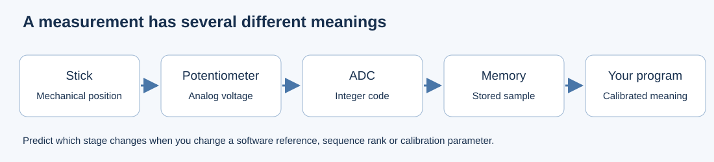

# A. Build a measurement, then explain it

An ADC measures voltage. It does not know that its input comes from a joystick,
what counts as the centre, or how far the stick can move. A digital input only
reports a logic level. Decide which information each one can preserve.

## What the converter does

Sampling selects a moment at which to measure the input. Quantization assigns
that sampled voltage to one numerical interval. An n-bit code has `2^n` possible
bit patterns, numbered from zero to `2^n - 1`. The reference voltage sets the
voltage span those intervals represent. For an ideal converter, the step size
is approximately `reference / 2^n`.

Two nearby voltages can fall into the same interval. Increasing sample rate
gives more measurements in time; increasing resolution gives more possible
codes. Neither removes reference error or electrical noise. The input circuit
also needs time to settle, so the shortest sampling-time setting is not always
appropriate.

This F103 prepares its converter with electrical self-calibration. That process
cannot discover a joystick's mechanical centre or endpoints. You will measure
those separately in C. The screen refreshes about every 100 ms; that interval
is not the ADC conversion time or the DMA transfer rate.

## Predict before coding

With a 12-bit ADC, how many distinct codes exist? What is the maximum code?
Write your predicted readings at 0 V, half the reference and near the reference.
Then explain whether two nearby voltages must produce different codes.

The reference assumption is 3300 mV. Sketch the relationship between ADC code
and estimated millivolts. Decide the order of arithmetic operations and the
integer width needed. Do not start from a copied C expression.

For this display exercise, use an **endpoint-scaled estimate**: zero code maps
to zero millivolts, and the largest code maps to the reference parameter. This
estimate is different from the ideal quantization-step model above. Explain
which calculation uses the number of codes and which uses the largest code.
Neither estimate establishes the reference's actual voltage or ADC accuracy.

## Inspect the prepared configuration

Open the IOC and `adc.c`. Find the selected channel, number of regular
conversions, trigger, continuous setting, sampling time and ADC clock.
The initial experiment uses one requested conversion on PA0. Explain why the
other three analog pins do not appear in this conversion's result.

Use the [API index](../hardware/api-index.md) to choose an acquisition sequence.
Draw a success path and a timeout path on paper before writing the function.
The timeout path must not display a stale conversion as a new successful value.

Trace the chosen HAL calls into the bundled source. Find the conversion-ready
flag check and the data-register read; identify these in your worksheet. Use
the ADC chapter of RM0008 to explain what the flag means. This is a source-reading
task, not a requirement to write a register driver from scratch.

## Implement three small contracts

In `Core/Src/lab_tasks.c`:

- `LabStudent_PrepareADC`: prepare/calibrate this F103 ADC once at startup.
- `LabStudent_ReadPolling`: return one completed raw reading, its HAL status,
  and bounded waiting. Finish an acquisition you started even when waiting fails.
- `LabStudent_ToMillivolts`: estimate voltage from raw and the reference parameter.

The screen and error labels are provided. No completed acquisition wrapper or
voltage calculation is included in this project. Keep the signatures in
`lab_tasks.h`, and replace the unfinished function bodies with your own work.

Build and program. Move the first stick along one axis while leaving the other
axes alone. Record readings at two stops and the released position in the
[worksheet](worksheet.md). Repeat a released reading several times.

## Change one assumption

Hold the stick in one position. Predict what will happen if the **software
reference assumption** changes from 3300 mV to 3000 mV, then change
`LAB_REFERENCE_MV`, rebuild and test. Do not change the board supply or wiring.
Explain which displayed quantity should change and why. Restore the assumption
after recording your observation.

Discuss a completed raw code of zero versus `HAL_TIMEOUT`: these are different
outcomes. Explain why increasing the TFT update rate cannot repair a conversion
that was never started, and why more ADC bits do not remove voltage-reference
error or noise.

Before moving to B, explain your sequence without reading the function names
aloud. Point to the line that makes a result valid, and to the error path.
