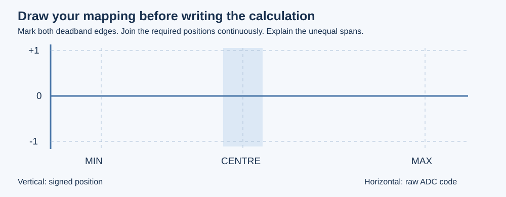

# B and C. Turn measurements into useful inputs

## B. Explain how four readings reach memory

A channel identifies an ADC input. A rank identifies when it appears in the
regular sequence. DMA moves results into memory; it does not label axes or
convert their values to positions. Continuous conversion and Circular DMA
control different parts of the process.

Follow a generated rank assignment into `HAL_ADC_ConfigChannel()` and locate
the sequence-register update. For DMA, explain which settings determine the
memory address increment and the width of each transfer. Sketch the offsets
of four halfword entries before predicting a rank exchange.

Follow the [configuration changes](../hardware/setup.md#changes-for-b-and-c).
Write the intended channel/rank/buffer relationship in your worksheet before
generating code. In `LabStudent_StartDMA`, start the supplied persistent buffer
once and report the actual HAL status. Do not restart it in the display loop.

Move one physical axis at a time. Determine which buffer entry changes rather
than assuming the array index is the ADC channel number. Record all four axes.

### Two experiments that require a prediction

1. Exchange two channels' ranks while retaining four distinct conversions.
   Predict which two displayed buffer entries will exchange roles. Generate,
   build, program and observe. Restore your intended order, or update the
   logical axis mapping in `LAB_AXIS_INDICES` to match it.
2. Keep the scan correct, but compare Normal and Circular DMA operation. Move a
   stick after startup. Does the result continue to change? Explain the buffer
   transfer count and why merely reading the same memory cannot restart DMA.

Restore continuous conversion, Circular DMA and the intended mapping before C.
This monitor reads axes independently; a four-element copy is not a simultaneous
sample of both sticks. No interrupt callback is needed for this exercise.

## C. Decide what the numbers should mean

Choose `LAB_CALIBRATION`. The screen retains raw readings while axis processing
is unfinished, so you can collect calibration first.

Measure the repeatable minimum and maximum of every axis. Release the stick,
take ten settled readings and estimate its centre and idle variation. Record
the measurements before changing `LAB_MINIMA`, `LAB_CENTRES` and `LAB_MAXIMA`.
These arrays are ordered J1X, J1Y, J2X, J2Y, independently of buffer order.

Define a signed position with a negative endpoint, zero at release and a
positive endpoint. Sketch it against raw code. Add a deadband around the centre
so idle variation is ignored. The line must join zero continuously at both
edges of that band. Explain why the positive and negative sides may need
different scale factors. Use the diagram to derive your calculation.

Implement `LabStudent_NormalizeAxis` in `lab_tasks.c`:

- Respect measured minimum, centre, maximum and the deadband parameter.
- Return zero for unusable calibration instead of dividing by an invalid span.
- Return a continuous signed value outside the deadband, limited to [-1, 1].
- Keep mechanical direction separate: the app applies `LAB_AXIS_DIRECTIONS`
  once, after your calculation. Do not reverse an axis twice.

There is no axis-processing helper in the starter. The earlier complete
reference is available, but each person should explain their own derivation and
demonstrate a changed calibration case.

### Test the relationship, not just one number

Predict the output at each endpoint, centre, each deadband edge and a position
halfway through usable travel on either side. Check values just outside both
edges. Your recorded midpoint need not be raw 2048, and an uncalibrated physical
stop need not produce magnitude 1.

Compare deadbands of 60 and 120 counts while keeping the calibration unchanged.
Record idle stability and how much movement is ignored. If both settings are
stable at release, explain the difference in response to small movements instead
of inventing jitter. Choose a value and justify it from your measurements.

Ask a partner or mentor to change one calibration parameter. Predict the effect
before rebuilding, then explain the observed output. Change one variable at a time.

## Optional extension: whole-stick displacement

Implement `LabStudent_StickExtent`. Combine signed X and Y into a
direction-independent magnitude from 0 to 1. Explain what happens diagonally and
why displacement is not force. The display labels unfinished extension work
`PUSH:TODO`; this does not prevent completing the required axis experiment.

## Share what you learned

Show the worksheet, your acquisition/error path, the changed-rank experiment
and the calibration comparison. A mentor may ask you to predict a new case or
point out a relevant IOC setting. This is feedback, not a new scored CW1.
