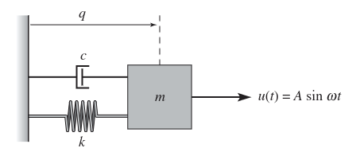
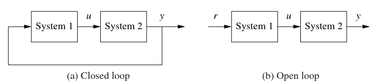
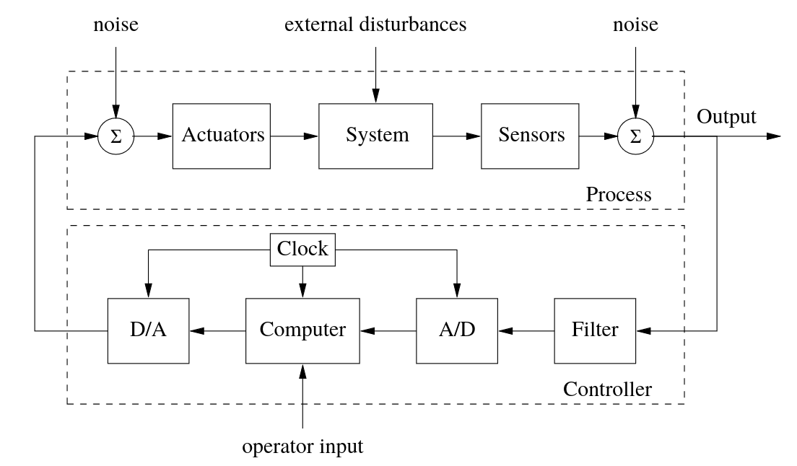
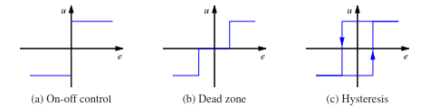

# Control Theory 101 [[up](./README.md), [next](./02-pid-control.md)]

Before talking about PID controllers, it would be a disservice if we do not talk about the basic theory and concepts of control. While this chapter is not strictly necessary for using and implementing PID control systems to achieve desirable results, understanding these concepts makes it easier to continue on further studies. ~~(such as ELEC3200 or MECH3610)~~

Since this is not, and cannot be, a complete course on Control Theory, we will **not** be dwelling on the Mathematics of control, like differential equations and Laplace transform. Rather, we will focus on a more qualitative and holistic understanding of the concepts in Control Theory.

## Why do we need control?

In the real world, we often interact with many _dynamic systems_ so that we can reach a desired state.

For example, we may want to control:

- the _speed_ of a car, by throttling the engine and applying breaks;
- the _temperature_ of a room, by changing how hard the air conditioner works; or
- the _position_ of a robotic arm, by applying current to joint motors.

However, these systems are often **complex** and subject to **disturbances** and **uncertainties**. While we _humans_ can learn to adapt to the complexities while interacting with these system, we need to _teach the silicon_ how to do the same.

This brings us to the discipline of **Control Theory**, which tries to

- model and predict the behavior of _dynamic systems_
- design _controllers_ that interact with theses systems to achieve our desired states

Control Theory encompasses a wide variety of things, including mechanical systems, biological processes, economics, electrical circuits, digital software, etc., describing and predicting how they interact and behave.

## Dynamical Systems and Models

A **dynamical system** is a system whose behavior _changes over time_, as opposed to _static systems_. Dynamic systems changes behavior often due to external stimulations and forcing. Basically all phenomenon in the real world are dynamical systems, with particular input and output dynamics.

In order to describe and predict the behavior of systems precisely, we employ **mathematical models** to represent them. In a model, there are four key components:

1. **State**: The state variables, often denoted as $x(t)$, describe the current intrinsic state of the system at specific times. These states can represent _physical quantities_, such as the angular velocity of a motor, the position and orientation of a drone in 3D space, or the temperature of a room; or they can also be _abstract_, such as CPU load and network traffic. The collection of all possible states and variables are known as the **state space**.

   If a state variable is (assumed to be) constant over time, we can call it a **parameter** of the system, such as electrical resistance and the mass of an object. Whether or not a variable is considered a parameter is highly dependent on the system we are describing. For example, we may consider the mass of a robotic arm to be constant, but the mass of a rocket including its fuel should not be assumed as constant.

2. **Input**: The inputs, often as $u(t)$, to a system describe external factors that can affect the behavior of the system, such as the current and voltage applied to a motor. By changing the input strategically, we are interacting with the system and changing its behavior to match our desired conditions.

3. **Output**: The outputs, often as $y(t)$, of a system are the behavior that is observable outside of the system. While in simple systems, they may coincide with the state variables, this is not a must. For example, in complex electrical circuits, state variables may describe the current and voltage of every internal wire, while the output only captures the final signal.

4. **Dynamics**: The dynamics of a system describes how the state variables _evolve over time_ given a input. They are expressed in the language of _differential equations_ and in simple terms: they relate the change of state variables and outputs with the current given state and inputs.

### Mathematical Representation of Dynamical Systems

This section talks about the actual Mathematics of systems modeling, which is not necessary for having a basic understanding the concepts of Control Theory in this tutorial. If you are not interested in the Mathematics, feel free to skip this section.

Since dynamical systems inherently depend on time, all variables in the system are _time-dependent_, and we can denote them as functions of time. For example, the state variable $x$ can be expressed as $x(t)$, similarly for the input variable $u(t)$ and output $y(t)$. We say they are **time-domain representations** of the system.

In this tutorial, we will only be considering single-input single-output systems, where the input and output are _scalar_ values. However, in general, since variables are rarely single values, we use **vectors** to represent them.

    

For example, in the above _driven spring-mass system with damping_, the physical dynamics of the system can be described using

$$
m \ddot{q} + c \dot{q} + k q = u
$$

Hence, to completely describe the system, we need to capture both the position $q$ and velocity $\dot{q}$, forming the **state vector** $x = (q, \dot{q})$. If we choose the output to be $y = (q)$, the complete dynamics can be expressed as the _second-order differential equation_:

$$
\frac{dx}{dt} =
\begin{bmatrix}
x_2 \\
-\frac cm x_2 - \frac km x_1 + \frac um
\end{bmatrix}
\qquad
y = x_1
$$

In general, we can express any **time-invariant** dynamical system in the _state-space representation_ as

$$
\frac{dx}{dt} = f(x, u) \qquad y = g(x, u)
$$

In addition, we can also represent the system in the _frequency domain_ using _Laplace transform_, which is often more convenient for analysis and design. In essence, we analyze the system using its response to sinusoidal inputs of different frequencies, or generally, complex exponentials. In this case, we can write the variables as functions of the complex frequency $s$, like $X(s)$, $U(s)$, and $Y(s)$. We will not go into the details of Laplace transform in this tutorial, but it is a very useful tool for analyzing and designing control systems, and often found in system block diagrams.

## Feedback

    

Since dynamic systems have defined input and outputs, we can compose separate systems by connecting their inputs and outputs. In the simplest case, we connect the output of System 1 to the input of System 2, forming an **open loop system**. Here, System 2 is only affected by System 1 and it is still relatively easy to reason about their dynamics.

To get more interesting behavior, we also connect the output of System 2 back to the input of System 1, creating a _feedback loop_ and forming a **closed loop system**. Due to this cross dependency between the systems, the behavior of feedback systems is often counter-intuitive and difficult to reason about. On the other hand, it also gives rise to more interesting behavior that an open loop system cannot capture.

Nonetheless, we can categorize feedback systems into two major types:

- **Positive feedback**: In a positive feedback system, an increase of the input or signal will be amplified by the feedback loop, which can lead to instability and destabilization of the system. A common example is with microphones and speakers, where the sound from the speaker is picked up by the microphone, amplified, and played again through the speaker, creating a loud screeching sound.

  Although this seems useless, positive feedback can be found in many biological systems, often with some form of _saturation_ to prevent the system from running away.

- **Negative feedback**: A negative feedback system, on the other hand, will try to _counteract_ disturbances to the signal and _stabilize_ the system. This _regulating effect_ is the core of designing control systems, and determining whether a system is _stable_ is one of the main focus of Control Theory.

## Control

Control, being the name-sake of Control Theory, is at the center of the discipline. **Control** refers to the use of _feedback_ and _algorithms_ in engineered systems. With this definition, control includes many examples, like feedback loops in electronics, setpoint controllers in chemical plants, and even network router protocols.

Usually, the **process** whose outcome we would like to control cannot be easily modified as they are governed by physical laws, and we can only _observe_ its behavior. In order to control the process, we need to design a **controller** that can _interact_ with the process and modify the behavior of the entire dynamical system as a whole. The goal of control is then to design controllers that can _stabilize_ a system and achieve a _desired outcome_.

    

In modern times, rather than designing controllers with analog electronics, we often use _digital computers_ to implement controllers through software and algorithms. This allows us to design more complex and sophisticated controllers that can achieve better performance.

In a typical control system, we have have a _closed loop_ feedback system between the controller and the process. The controller receives feedback from **sensors** and compares it with the _operator input_ or a _setpoint_. Based on this comparison, the controller produces an output that _commands_ actuators in the process. The process then produces an output that is _measured_ by the sensors, and the cycle continues.

In simple controllers, the comparison between the feedback and setpoint is often a simple _subtraction_ operation, producing an **error signal** $e(t)$ that is then used to compute the controller output. In more complex controllers, the comparison can be a more sophisticated function that takes into account more data, such as the history.

### Simple Feedback Control Methods

One of the simplest feedback control methods is **on-off control**, also known as **bang-bang control**. In this method, the controller simply turns the actuator fully on or fully off based on whether the measured output is above or below the setpoint:

$$
u =
\begin{cases}
    u_\text{max} & \text{if } e > 0, \\
    u_\text{min} & \text{if } e < 0,
\end{cases}
$$

    

This is simple to implement and can be generalized to have more than two states. However, it is not very efficient and often lead to oscillations around the setpoint. While this could be partially resolved by introducing _dead zones_ and _hysteresis_, this simplistic control method is often not sufficient for more complex systems.

### Model-Based Control

Another category of control methods is **model-based control**, where we use a mathematical model of the process to _predict its behavior_ and compute the optimal control action. This can be done through techniques like **state feedback control**, **optimal control** (such as **Linear-quadratic regulator**), and **model predictive control**.

Although this is a very powerful method, it requires a good model of the process, which can be difficult to obtain. In addition, the computation required for these methods can be expensive and may not be feasible for real-time control in some computationally-constrained systems. Not to mention, the theory and mathematics behind these methods are often more complex and require a deeper understanding of control theory.

### PID Control

In this tutorial, we will focus on **PID control**, which is a simple yet effective control method that does not require a model of the process. It is widely used in industry and has been proven to work well in many applications. In the next chapter, we will dive into the details of PID control and how to implement it in practice.

## Determining the behavior of a system

In determining the behavior of a system, we often want to know

1. How it responds to a sudden change in input? This is known as the **step response** of the system, and it can tell us about the stability, speed, and overshoot of the system.

2. What is the long-term behavior of the system? This is known as the **steady-state response** of the system, and it can tell us about the accuracy and precision of the system at equilibrium.

3. How stable is the system? This is known as the **stability** of the system, and it can tell us whether the system will converge to a desired state or diverge away from it.

While we can analyze the behavior of a system analytically using mathematical models, we can also determine the behavior of a system empirically through **experiments**, especially when we do not have an accurate model. By applying known inputs to the system and measuring the outputs, we can characterize the system's behavior and use that information to design and tune controllers.
