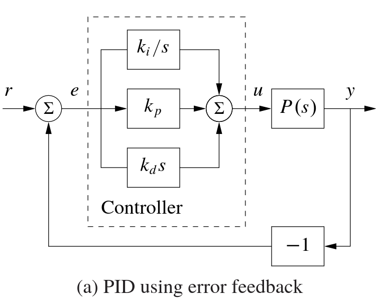
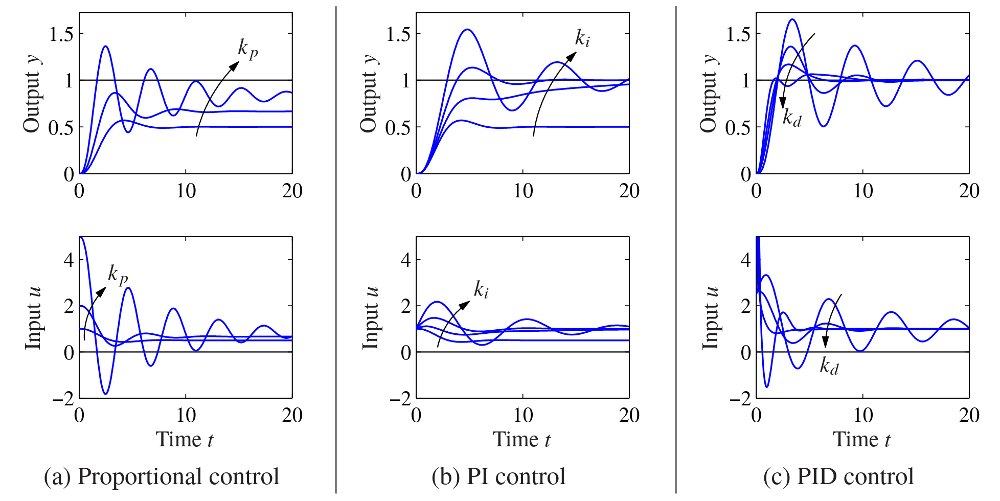
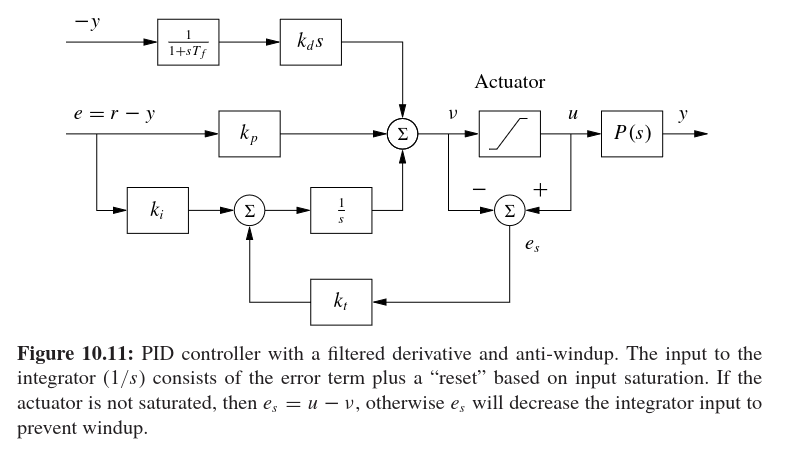
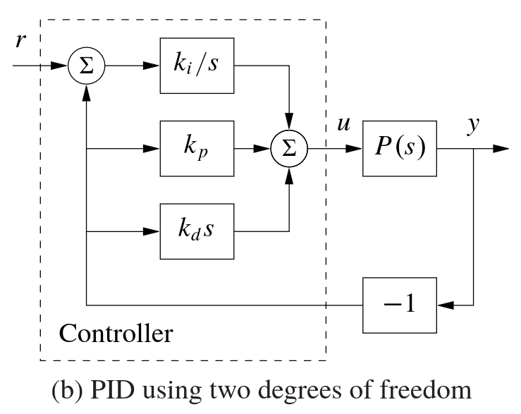
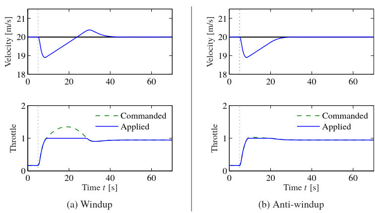

# PID Control Theory [[up](./README.md), [prev](./01-control-theory.md), [next](./03-can.md)]

The **proportional–integral–derivative controller** (PID controller) is a control loop feedback mechanism widely used in industrial control systems. The appeal is that

1. it is simple to understand and implement,
2. it does not require a model of the system, and
3. it can be tuned to achieve relatively good performance.

In this chapter, we will introduce the PID controller, explain how it works, and show how to implement it in code.

## The Ideal PID Controller

In this section, we will introduce the most basic PID controller and go over the Mathematics behind it, together with some qualitative explanations of what the math means. This section is **not optional** as you will need to understand the math in order to implement the controller correctly.

    

A PID controller is a **single-input, single-output** controller. The controller is given a target setpoint $r(t)$ which is will try to "chase" by controlling $u(t)$. The controller receives feedback from the system in the form of a measurement $y(t)$, which is compared to the setpoint to calculate the error $e(t) = r(t) - y(t)$. The controller then uses this error to compute the control signal $u(t)$.

In the example of a motor speed controller, the setpoint $r(t)$ is the target angular velocity, the measurement $y(t)$ is the actual angular velocity, and the control signal $u(t)$ is the current applied to the motor.

### The (Scary) Math

The PID controller is defined mathematically as follows:

$$
u = k_p e + k_i \int_0^t e(\tau) d\tau + k_d \frac{de}{dt}
$$

> [!NOTE]
> Some literature also uses the following alternative form:
>
> $$
> u = k_p \left( e + \frac{1}{T_i} \int_0^t e(\tau) d\tau + T_d \frac{de}{dt} \right)
> $$
>
> where $T_i$ and $T_d$ has units of time, and have some additional physical meaning.

As the name suggests, the PID controller has three terms:

- **Proportional**: The proportional term is the most basic part of the controller. It simply multiplies the error by a constant $k_p$ to produce a control signal. The proportional term is responsible for reducing the error, but it cannot eliminate it completely.

- **Integral**: The integral term is responsible for eliminating the _steady-state error_. It does this by integrating the error over time and multiplying it by a constant $k_i$.

- **Derivative**: The derivative term is responsible for predicting the future error, and reduce overshoot. It does this by taking the derivative of the error and multiplying it by a constant $k_d$.

By tuning the three constants $k_p$, $k_i$, and $k_d$, we can achieve different control behaviors. Ideally, we would like to have a controller that is

- **Fast**: Responds quickly to changes in the setpoint or disturbances.
- **Accurate**: Minimizes the steady-state error.
- **Stable**: Does not oscillate or overshoot excessively.

### Qualitative Explanation

In this section, we will try to build up to the PID controller from a intuitive perspective, and have a qualitative understanding on the effects of tuning the parameters $k_p$, $k_i$, and $k_d$.

    

The above figure shows the _step response_ ($r$ goes from $0 \mapsto 1$) of a PID controller with different parameter settings.

Starting with only the proportional term in (a), the control action $u$ is proportional to the error $e = r - y$. Hence, beginning with a large error, the control action is large, and the system responds quickly. However, as the system approaches the setpoint, the error decreases, and so does the control action.

- As we increase $k_p$, the initial response becomes faster, but the oscillation also increases as it overshoots the target.
- At low $k_p$, although the system is stable, it takes a long time to reach a steady-state as it asymptotically approaches a fixed value.

With only the proportional term, the system will always have a steady-state error. This is because the system cannot account for constant disturbances: when the error is zero, the control action is also zero, and the system cannot counteract the disturbance. Some common sources of these errors are friction, gravity, and other types of resistance.

To address this, we introduce the integral term in (b), Since the integral term accumulates the error over time, it will continue to increase / decrease the control action until the error is eliminated. When the system reaches a steady-state, the error is zero, and the integral term stops accumulating. This allows the system to eliminate the steady-state error.

- At low $k_i$, the system will again take a long time to eliminate the steady-state error, unaccounted for by the proportional term. However, it will be stable and not oscillate.
- At high $k_i$, the system will eliminate the steady-state error quickly, but it may oscillate and overshoot the target.

> [!NOTE]
> There are also other ways to eliminate steady-state error, such as using a feedforward term or a disturbance observer. However, they may require additional knowledge about the process model, and the integral term is the most common approach to "automatically generate" a feedforward term.

As we see, both the proportional and integral terms may introduce oscillations as they overshoot the target. To counteract this, we introduce the derivative term in (c) to introduce a _damping effect_. The derivative term predicts the future error by looking at the rate of change of the error. If the error is decreasing quickly, the derivative term will reduce the control action, preventing overshoot.

- At a low or zero $k_d$, the system has little damping, and will oscillate around the target. This is known as an _under-damped system_.
- As we increase $k_d$, the system will have more damping, and will reach the target without oscillating. However, if $k_d$ is too high, the system will become _over-damped_, and will take a long time to reach the target.
- The ideal value of $k_d$ is somewhere in between, where the system reaches the target quickly without oscillating, known as a _critically-damped system_.

## Implementing the PID Controller

Previously, we have defined the PID controller using continuous-time functions. However, in practice, we will be implementing the controller in discrete-time using a microcontroller. In this section, we will show how to implement the PID controller in code.

> [!IMPORTANT]
> We will **not** be providing a complete implementation of the PID controller. Instead, we will focus **how** you can implement the controller by describing the Mathematics, and leave the details to you.
>
> With the Internet and AI, we believe that you can find many implementations of the PID controller online. However, we will provide some guidance on how to implement and tune the controller correctly.

### The Simple Approach

Fundamentally, the PID controller is given using differential equations. In our implementation, we will need to perform two tasks:

1. Convert the continuous-time equations into discrete-time equations, and
2. Numerically estimate the integral and derivative of the error term.

If you have taken any course on numerical methods, you may be familiar with the **Euler method** for solving ordinary differential equations numerically. The Euler method is a simple way to approximate the solution of a differential equation by using a finite difference approximation. In our case, we will be using it to estimate the integral and derivative of the error term with discrete time steps.

Denote the fixed time step as $h$, and the _sampling time_ as $t_k$ with $t_{k+1} = t_k + h$. We will also introduce the following commonly used notation, where $f[ \cdot ]$ is used to denote the discrete-time version of a continuous-time function:

$$
r[k] = r(t_k), \quad y[k] = y(t_k), \quad u[k] = u(t_k), \quad \text{etc.}
$$

We can then rewrite the PID controller in discrete-time as:

$$
u[k] = P[k] + I[k] + D[k]
$$

where $P[k]$, $I[k]$, and $D[k]$ are the discrete-time versions of the proportional, integral, and derivative terms, respectively.

The proportional term is simply given by

$$
P[k] = k_p \cdot e[k], \quad \text{where} \quad e[k] = r[k] - y[k]
$$

To estimate the integral term, we can use the _Forward Euler method_:

$$
I[k+1] = I[k] + k_i \cdot h e[k]
$$

This updates the integral term by adding the current error multiplied by the time step $h$ to the previous integral term.

To estimate the derivative term, we can use the _Backward Euler method_:

$$
D[k] = k_d \cdot \frac{e[k] - e[k-1]}{h}
$$

With this implementation, we need to store the previous error $e[k-1]$ and an accumulated integral term $I[k]$ in order to compute the control signal $u[k]$.

### Tuning the Parameters

After implementing the PID controller, we will need to tune the parameters $k_p$, $k_i$, and $k_d$ to achieve the desired performance. There are many methods for tuning the parameters, such as **Ziegler–Nichols method** or other **pole-placement methods**. However, we will instead describe an intuitive empirical method for tuning the parameters.

> [!TIP]
> In order to observe the effects of tuning the parameters, it is helpful to have a way to visualize the system's response. This can be done by plotting the setpoint, measurement, and control signal over time. For example, you can use a serial plotter to visualize the data in real-time, or log the data to a file and plot it later.

The fundamental idea is to tune one parameter at a time, while observing the system's step response. Here is one way to approach tuning:

1. Start with $k_i = k_d = 0$.

2. Slowly increase $k_p$. Initially, it will take a long time to reach the setpoint, this means that you need to increase $k_p$ further. As $k_p$ increases, the oscillations also increase. You want to find a value of $k_p$ that is high enough to reach the setpoint quickly, but not too high that it oscillates excessively.

    

3. Observe the steady-state error, and slowly increase $k_i$ to eliminate it. You want to find a value of $k_i$ that is high enough to eliminate the steady-state error, but not too high that it introduces oscillations.

> [!WARNING]
> The value of $k_i$ is usually **orders of magnitude smaller** than $k_p$ and $k_d$. If $k_i$ is too high, it may introduce unstable oscillations, sometimes even a "semi-positive" feedback loop, which can be dangerous for the system.

    

4. Increase $k_d$ to remove the overshoot and oscillations. You want to find a value of $k_d$ that is high enough to dampen the oscillations, but not too high that it slows down the response, or reintroduces high frequency oscillations. The reason for the high frequency oscillations and how to avoid them by changing the implementation will be discussed in the next section.

    

5. Repeat steps 2-4 until you are satisfied with the performance. You may need to go back and forth between the parameters to find the optimal values.

## Other Considerations

    

### Derivative Kick and 2-DOF PID Controllers

In the above discussion, we have assumed that the setpoint $r$ is (mostly) constant. However, in practice, the setpoint may change over time, sometimes with a discontinuous jump. This will cause the error $e$ to also change discontinuously.

Since the derivative term is proportional to the rate of change of the error, a discontinuous change in the error will cause a large spike in the derivative term. This can cause a problem known as **derivative kick**, where the control signal $u$ will have a large spike, which may cause the system to overshoot or oscillate.

    

This can be mitigated by using a **2-DOF PID controller**: instead of directly operating on the error, it takes separates the setpoint and measurement inputs, and only applies the derivative term to the measurement. This way, the derivative term will not be affected by discontinuous changes in the setpoint. In this case, the derivative term is given by

$$
    D(t) = k_d \cdot -\frac{dy}{dt} \qquad D[k] = k_d \cdot -\frac{y[k] - y[k-1]}{h}
$$

In general, the 2-DOF PID controller is given by

$$
u = k_p (b r - y) + k_i \int_0^t (r(\tau) - y(\tau)) d\tau + k_d \frac{d}{dt} \left( c r - y \right)
$$

where $b$ and $c$ are the setpoint weights for the proportional and derivative terms, respectively. The 2-DOF PID controller allows for more flexibility in tuning the controller, and can improve the performance of the system.

### Integrator Windup

In an ideal linear setting, the control action can be arbitrarily large. However, in practice, the control action is usually limited by the physical constraints of the system. For example, a motor can only provide a limited amount of torque with a maximum current. When the control action reaches this limit, the system becomes _saturated_.

In this scenario, the integral term will continue to accumulate as the error decreases slowly, and the control action will remain saturated. When the system finally reaches the setpoint, since the accumulated integral term is too large, the control action will remain saturated for a while, and the system will overshoot the setpoint. This is known as **integrator windup**.

    

There are many methods to avoid windup, such as **back-calculation** and **conditional integration**. The basic idea is to prevent the integral term from accumulating when the control action is saturated.

- Conditional integration is the simplest approach: where the integral term is only updated when the control action is not saturated. This can be implemented by checking if the control action is within the limits before updating the integral term.
- Back-calculation is a more sophisticated approach: where the integral term is updated based on the difference between the control action and the saturated control action. This can be implemented by adding a feedback term to the integral term, which will reduce the integral term when the control action is saturated. This is shown in the above figure.

### Derivative Filtering

If we quickly look at the frequency domain representation of the PID controller and focus on the derivative term:

$$
U(s) = \left( k_p + \frac{k_i}{s} + k_d s \right) E(s)
$$

We can see that the derivative term has a _high gain_ for high-frequency signals. This means that the derivative term will amplify high-frequency noise in the measurement, which can cause the control action to oscillate or become unstable. This also explains the system starts to oscillate when $k_d$ is too high.

One way to avoid this is to replace the derivative term with a **low-pass filtered derivative**:

$$
U(s) = \left( k_p + \frac{k_i}{s} + \frac{k_d s}{T_f s + 1} \right) E(s)
$$

where $T_f$ is the time constant of the low-pass filter. This will reduce the gain of the derivative term for high-frequency signals, and improve the stability of the system. In a discrete-time implementation, this can be implemented using a simple first-order low-pass filter when estimating the derivative:

$$
D[k] = \frac{T_f}{T_f + h} D[k-1] - \frac{k_d}{T_f + h} (y[k] - y[k-1])
$$

## Further Reading

To learn more about Control Theory and PID Controllers, you can either take courses like ELEC3200, or read textbooks on the subject, such as

- K. Astrom and R. M. Murray, “Feedback systems: an introduction for scientists and engineers”
- Richard C. Dorf and Robert H. Bishop, “Modern Control Systems”

For some hands-on experience with PID controllers, you can also try playing the [PID Game](https://janismac.github.io/ControlChallenges/), which is a simple simulation that allows you to implement and tune a PID controller and see the effects on the system's response.

If you really do not like reading, you can also watch some videos on the subject. I trust that you will find them more entertaining than reading textbooks. :)
