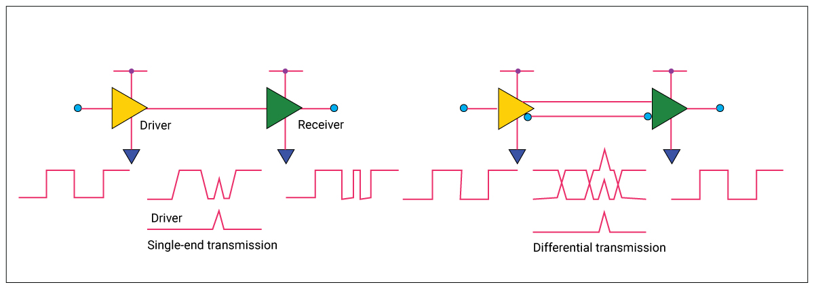
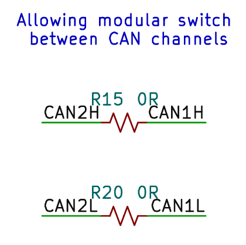
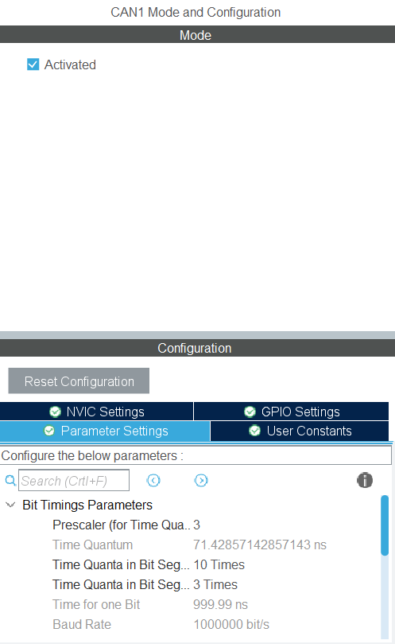
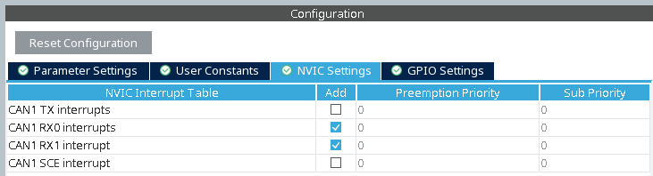

# What even is CAN? [[up](./README.md), [prev](./02-pid-control.md), [next](./04-rm-motor.md)]

In the previous tutorials, we have introduced many serial communication protocols, including

- **UART**: an _asynchronous_, _full-duplex_ protocol, used with USB-TTL converters and HC-05 Bluetooth modules.
- **I2C**: a _synchronous_, _half-duplex_, _multi-master_, _multi-drop_ _bus_ protocol, used with sensors like the ToF.
- **SPI**: a _synchronous_, _full-duplex_ protocol, used to control the TFT display.

In this chapter, we will introduce another serial communication protocol called **CAN** (Controller Area Network), which is widely used in automotive and industrial applications. In our case, we will be using CAN to communicate with RM motors, which are introduced in the next chapter.

## Specifications of CAN

Following the word-salad above, we can describe CAN as an _asynchronous_, _half-duplex_, _multi-master_, _multi-drop_ _bus_ protocol, with _differential signals_ carried over a _twisted pair_, _lossless bitwise arbitration_, and _CRC error detection_. This section will unpack these terms and explain what they mean.

CAN bus comes in many flavors over different standards under the _ISO 19898 family_. The most widely seen today is **CAN 2.0**, such supports bit rates of up to _1 Mbps_, with _11-bit_ (CAN 2.0A) and _29-bit_ (CAN 2.0B) identifiers. There are also other compatible new CAN standards, such as _CAN FD_ and _CAN XL_, which supports higher data rates and other new features.

Since the STM32F405 MCU and the RM motor ESC only supports CAN 2.0, we will focus only on that.

### Physical Layer

<p algin="center"><a href="https://commons.wikimedia.org/wiki/File:CAN_ISO11898-2_Network.png#/media/File:CAN_ISO11898-2_Network.png"></a><br>By <a href="//commons.wikimedia.org/w/index.php?title=User:EE_JRW&amp;action=edit&amp;redlink=1" class="new" title="User:EE JRW (page does not exist)">EE JRW</a> - <span class="int-own-work" lang="en">Own work</span>, <a href="https://creativecommons.org/licenses/by-sa/4.0" title="Creative Commons Attribution-Share Alike 4.0">CC BY-SA 4.0</a>, <a href="https://commons.wikimedia.org/w/index.php?curid=38256600">Link</a></p>

CAN is a _multi-drop_ _bus_ serial protocol. This means that multiple CAN devices can connect to a singular bus, with wires _dropping_ from it, similar to I2C. As an aside, some other bus protocols may employ _daisy-chaining_, such as the WS2712B addressable LEDs.

<p align="center"><a href="https://commons.wikimedia.org/wiki/File:ISO11898-2.svg#/media/File:ISO11898-2.svg"></a><br>By <a href="//commons.wikimedia.org/w/index.php?title=User:EE_JRW&amp;action=edit&amp;redlink=1" class="new" title="User:EE JRW (page does not exist)">EE JRW</a> - <span class="int-own-work" lang="en">Own work</span>, <a href="https://creativecommons.org/licenses/by-sa/4.0" title="Creative Commons Attribution-Share Alike 4.0">CC BY-SA 4.0</a>, <a href="https://commons.wikimedia.org/w/index.php?curid=55237229">Link</a></p>

CAN is carried over _a twisted pair_ of wires with _differential signaling_: meaning that one wire, called **CAN-H**, carries a "positive" signal, while the other, called **CAN-L** carries a "negative" signal. Since this is very different from the usual TTL or CMOS voltage levels, most devices need a dedicated _CAN transceiver_ to translate these signals.

By default, the two wires are in the _recessive_ state (bit 1) with the same voltage. When some device is transmitting, it can drive the wires to a _dominant_ state (bit 0) with a different voltage between the two wires. When reading the value from the CAN bus, the CAN transceiver finds the _difference_ between the two wires, and determine if it is a 0 or 1 bit. Hence, this is called _differential signaling_.

> [!TIP]
> Remember to check which wire is CAN-H, and which is CAN-L. While reversing the polarity will typically not break anything, the connected device will not be able to communicate with other devices on the bus.

<p align="center">
    
</p>

One of the advantages of using differential signaling in a twisted pair is that it is more robust to noise, especially in electrically noisy environments, such as near motors. This is because any noise will affect both wires equally, and be canceled out when taking the difference. It also allows for longer cable lengths, compared to ~~the very bad~~ I2C.

### Data Transmission

Although the CAN bus has two wires, they are used together to transmit only _one bit stream_, the data stream. Therefore, unlike UART, CAN is _half-duplex_ and can only either send or receive at one time. Also, unlike I2C, CAN is _asynchronous_, i.e. lacking a shared clock signal. Instead, the devices on the bus must agree on a _bit rate_ (e.g. 1 Mbps) and transmit data at that speed. However, CAN bus also have mechanisms to synchronize the bit timings between devices, so that they can still communicate even if their clocks are not perfectly aligned.

CAN is a _multi-master_ protocol, which means that any device on the bus can initiate a transmission at any time. However, if two devices try to transmit at the same time, a _lossless arbitration_ mechanism is used to determine which device gets to send its message. This is done by comparing the identifiers of the messages being sent, with the lower identifier winning the arbitration. The losing device will then wait and try again later. For this reason, when starting a transmission, it is undetermined when the message will be sent successfully, or if it ever will.

Since CAN is a _multi-drop_ bus, all devices on the bus will receive the same message. However, each device can choose to ignore messages that are not relevant to it, by using _message filtering_. This allows for efficient communication between multiple devices on the same bus.

### Message format

<p align="center"><a href="https://commons.wikimedia.org/wiki/File:CAN-bus-frame-with-stuff-bit-and-correct-CRC.png#/media/File:CAN-bus-frame-with-stuff-bit-and-correct-CRC.png"></a><br>By Ken Tindell, Canis Automotive Labs Ltd, <a href="https://creativecommons.org/licenses/by-sa/4.0" title="Creative Commons Attribution-Share Alike 4.0">CC BY-SA 4.0</a>, <a href="https://commons.wikimedia.org/w/index.php?curid=109636302">Link</a></p>

In CAN 2.0, there are both base and extended frame formats, with _11-bit_ and _29-bit_ identifiers respectively. In this tutorial, we will only cover the base frame format, which is used by the RM motors. Albeit, the extended frame format is very similar, with only 18 additional bit bits after IDE for the longer identifier.

A standard CAN 2.0A message consists of the following fields:

1. Start-of-frame (SOF): 1 bit, indicates the start of a message.
2. Identifier: 11 bits, identifies the message and its priority.
3. Remote Transmission Request (RTR): 1 bit, indicates if the message is a data frame or a remote frame.
4. Identifier Extension (IDE): 1 bit, indicates if the message uses a standard (0) or extended (1) identifier.
5. Data Length Code (DLC): 4 bits, indicates the number of data bytes (0-8) in the message.
6. Data field: 0-8 bytes, the actual data being transmitted.
7. Cyclic Redundancy Check (CRC): 15 bits, used for error detection.
8. ACK: 2 bits, used for acknowledging the receipt of a message.
9. End-of-frame (EOF): 7 bits, indicates the end of a message.

Applications can freely define their own message formats and protocols on top of the CAN message format, as long as they adhere to the basic structure and rules of CAN.

## Using CAN with STM32

In this section, we will discuss how to use the CAN peripheral on the STM32F405 MCU to send and receive messages. Although we have already provided the necessary library code to use CAN and communicate with RM motors, you will still have to **configure the CAN peripheral** on your own in STM32CubeMX.

The STM32F405 has two CAN peripherals, CAN1 and CAN2, which can be used independently. In this tutorial and in RDC, we will only be using CAN1.

> [!NOTE]
> While the mainboard does have two CAN transceivers, one for each CAN peripheral, the two buses are connected together with 0R resistors. If for any reason you would like to use both CAN buses separately, you will have to remove the 0R resistors.
> 

### Configuration

In STM32CubeMX, you will have to activate and configure the CAN1 peripheral (under Connectivity > CAN1). Make sure that you use the following settings to get a Baud Rate of 1000000 bit/s:

<p align="center">
    
    
</p>

> [!TIP]
> If you change the Prescaler first, STM32CubeMX may prevent you from changing the Time Quanta fields correctly. Therefore, you should change the Time Quanta fields first, and then change the Prescaler to avoid error messages.

After this, remember to **generate code**. Then, you should see the files `Core/Inc/can.h` and `Core/Src/can.c` in your project, with the following in your `main` function:

```c
    // ...
    MX_CAN_Init(&hcan1);
    // ...
```

### Sending, Receiving, and Filtering Messages

In order to use the CAN peripheral, you will have to first configure it:

```c
CAN_FilterTypeDef filter_config = {
    // Details of the filter configuration will depend on
    // your application and the messages you want to receive.
    // ...
    .FilterFIFOAssignment = CAN_FILTER_FIFO0,
    .FilterActivation = ENABLE,
    // ...
};
HAL_CAN_ConfigFilter(&hcan1, &filter_config);
HAL_CAN_Start(&hcan1);
HAL_CAN_ActivateNotification(&hcan1, CAN_IT_RX_FIFO0_MSG_PENDING);
```

This does a few things:

- Configures the CAN filter to accept messages with certain identifiers.
- Starts the CAN peripheral to begin sending and receiving messages.
- Activates the interrupt for receiving messages in FIFO 0.

To send a data frame in the base frame format, you can use the following code:

```c
CAN_TxHeaderTypeDef tx_header = {
    .StdId = id,
    .IDE = CAN_ID_STD,
    .RTR = CAN_RTR_DATA,
    .DLC = data_length,
};
uint32_t tx_mailbox;
HAL_CAN_AddTxMessage(&hcan1, &tx_header, data, &tx_mailbox);
```

This will "queue" the message to be sent on the CAN bus. The actual transmission will happen in the background, and you can check if it was successful by checking the status of the mailbox, using:

```c
HAL_CAN_GetTxMailboxesFreeLevel(&hcan1)
HAL_CAN_IsTxMessagePending(&hcan1, tx_mailbox)
```

Whenever a CAN message matching the filter is received, the `HAL_CAN_RxFifo0MsgPendingCallback` function will be called. You can implement this function in your code to handle the received message:

```c
void HAL_CAN_RxFifo0MsgPendingCallback(CAN_HandleTypeDef *hcan) {
    CAN_RxHeaderTypeDef rx_header;
    uint8_t data[8];
    HAL_CAN_GetRxMessage(hcan, CAN_RX_FIFO0, &rx_header, data);
    // Process the received message
}
```
