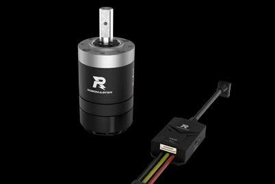
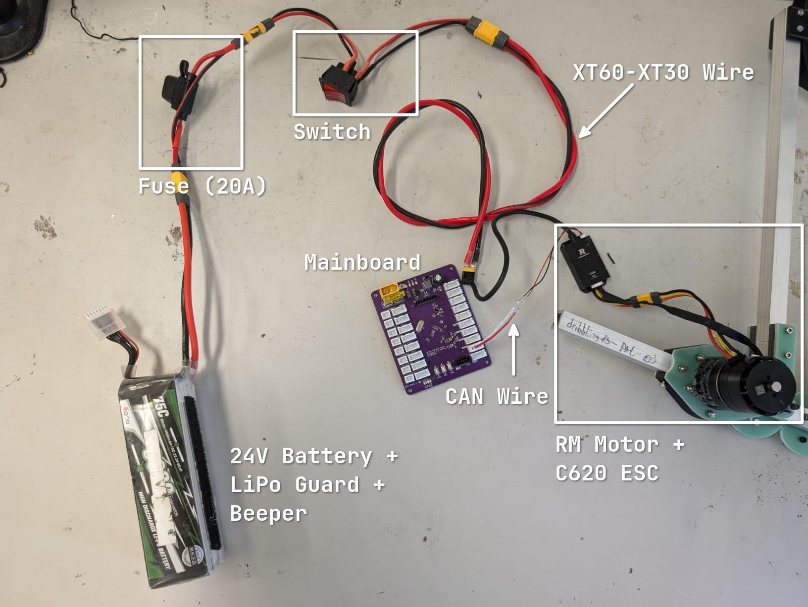
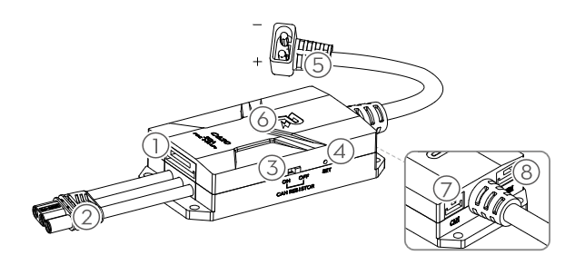
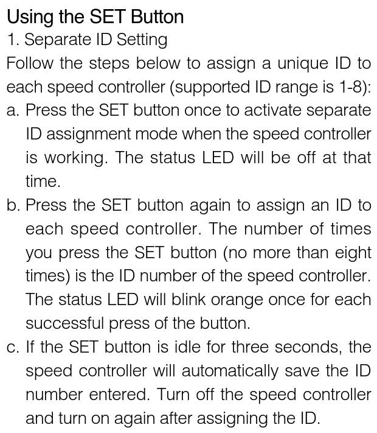
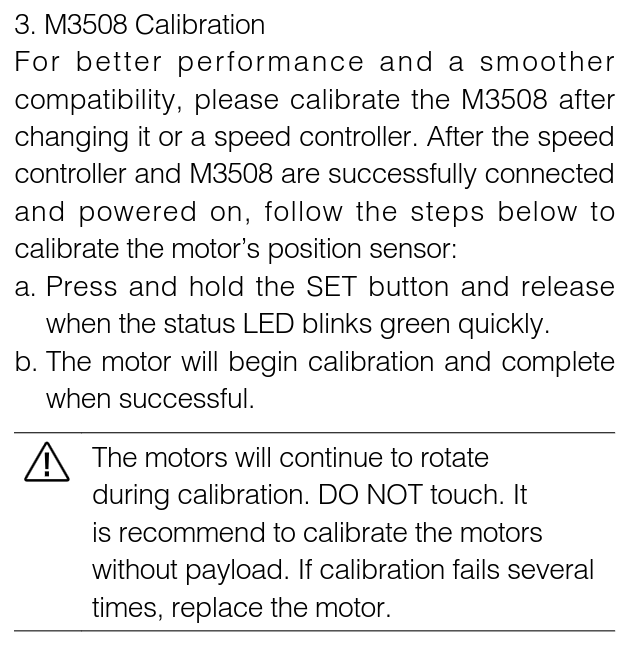
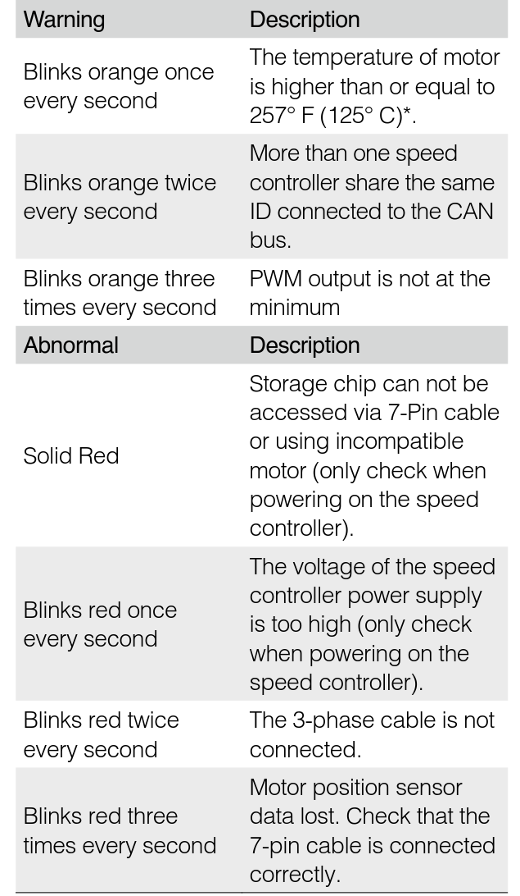

# Using the RM Motors [[up](./README.md), [prev](./03-can.md)]

In RDC, you will be using Robomaster M3805 motors made by DJI. These are _brushless_ DC motors, with a built-in _encoder_ (more specifically a _hall effect sensor_) for position feedback. The motors are controlled by C620, an _electronic speed controller_ (ESC) that communicates with the Mainboard via the CAN bus.

<p align="center">
    
</p>

## Wiring

Hopefully, your Hardware members have already prepared the necessary wires for you. If not, you will try borrowing from others.

<p align="center">
    
</p>

<p align="center">
    
</p>

Since all the wires and connectors are keyed, you should not have to worry about connecting the wrong wires, ~~assuming all the wires are made correctly~~. Here are the steps to wire up the motors to the Mainboard:

1. Connect the M3805 motor to a C620 ESC: connecting both the _3-phase power wires_ **(2)** and the _encoder wires_ **(1)**.
2. Connect the C620 ESC to the Mainboard using a CAN wire **(7)**.
3. Connect the C620 ESC to the battery **via the fuse and swtich** **(5)**.

> [!IMPORTANT]
> You should power on the system in this specific order for **safety**:
>
> 1. Battery power to motors
> 2. Mainboard via battery or ST-link
>
> When powering down, you should power off the **motors first**, then **Mainboard**.
>
> **Always** power off the motors before flashing code onto your Mainboard.

## Configure the RM ESC ID

Since the RM motors are connected via a single CAN bus, each motor must have a _unique ID_, referred to as the **RM ESC ID**, to avoid conflicts. By the design of their protocol, each CAN bus can support up to _8 motors_, with IDs ranging from 1 to 8. If you have multiple motors connected to the same CAN bus, you will have to change the ID of each motor (ESC) to a unique value.

> [!NOTE]
> The RM ESC ID is different from the CAN ID. Details of the actual CAN protocol used by C620 can be found in its [datasheet](./references/c620_datasheet.pdf).

Follow the steps below to configure the RM ESC ID of your motors using the SET button **(4)**:

<p align="center">
    
</p>

After setting the RM ESC ID, you can verify that the ID has been set correctly by checking if the status LED blinks green the correct number of times. For example, if you set the RM ESC ID to 3, the status LED should blink 3 times.

## Calibrating

Similar to all brushless motors, the RM motors require calibration to determine the correct electrical characteristics of the motor. The calibration process is done automatically by the C620 ESC using the following instructions:

<p align="center">
    
</p>

## Status LED

The following table shows the different status LED colors ~~when something went wrong~~:

<p align="center">
    
</p>

## Using the `rm_motor` library

Since we are nice people, we have already written a library for you to use the RM motors. The library can be found in the `./code/` directory, consisting of `rm_motor.h` and `rm_motor.c`.

To add the library to your existing project:

1. Copy the files into your project's `Core/Inc` and `Core/Src` respectively.
2. Edit your `CMakeLists.txt` to include the new source file:
   ```cmake
   target_sources(${PROJECT_NAME} PRIVATE
        # Add user sources here
        Core/Src/rm_motor.c
        # ...
   )
   ```
3. Reconfigure your project and rebuild.

To use the library, make sure that you have already configured your CAN1 peripheral. In `main.c`, include the header:

```c
#include "rm_motor.h"
```

And in your `main` function, write:

```c
    // ...
    rm_can_init(&hcan1);
    uint32_t rm_last_tick = HAL_GetTick();
    while (1)
    {
        // ...
        if (HAL_GetTick() - rm_last_tick >= 1) {
            rm_ctrl_loop(&hcan1);
            rm_last_tick = HAL_GetTick();
        }
        // ...
    }
```

Each motor is identified by its RM ESC ID and enum variant:

```c
typedef enum {
    RM_MOTOR_1 = 0,
    RM_MOTOR_2,
    RM_MOTOR_3,
    RM_MOTOR_4,
    RM_MOTOR_5,
    RM_MOTOR_6,
    RM_MOTOR_7,
    RM_MOTOR_8,
    NUM_OF_RM_MOTORS,
} RM_Motor;
```

Then you can simply use the functions provided in the library to control and get the feedback of the motors. Since you can only control the current of the motors, you will have to implement your own PID control loop to control the velocity or position of the motors.

> [!NOTE]
> As a safety precaution, the library defines a soft limit on the maximum current:
>
> ```c
> // rm_motor.h
> #define RM_CURRENT_SOFT_MAX 5.0f
> ```
>
> You **are allowed** to change this value, up to 20A, but you should be careful not to damage the motors or the ESCs by holding the motors at a high current for too long. The motors will get hot and may be damaged if you do not take care of them.

### Example Code Snippet

This is a very simple example of how to use the library to control a single motor:

```c
// main.c - in main
// ...
rm_can_init(&hcan1);
RM_Motor motor = RM_MOTOR_1;
uint32_t led_last_tick = HAL_GetTick();
uint32_t rm_last_tick = HAL_GetTick();
while (1)
{
    if (HAL_GetTick() - led_last_tick >= 20) {
        gpio_toggle(LED_D5);
        led_last_tick = HAL_GetTick();
    }

    if (HAL_GetTick() - rm_last_tick >= 1) {
        rm_ctrl_loop(&hcan1);
        rm_last_tick = HAL_GetTick();
    }

    tft_prints(0, 0, "cur: %.1f", rm_get_actual_current(&hcan1, motor));
    tft_prints(0, 0, "enc: %d", rm_get_encoder(&hcan1, motor));
    tft_prints(0, 0, "vel: %d", rm_get_actual_vel(&hcan1, motor));

    if (btn_read(BTN1)) {
        rm_set_current_setpoint(&hcan1, motor, 1.5f);
    } else if (btn_read(BTN2)) {
        rm_set_current_setpoint(&hcan1, motor, -1.5f);
    } else {
        rm_set_current_setpoint(&hcan1, motor, 0.0f);
    }
}
```

## Additional Resources

- RM C620 Datasheet: [link](./references/c620_datasheet.pdf)
