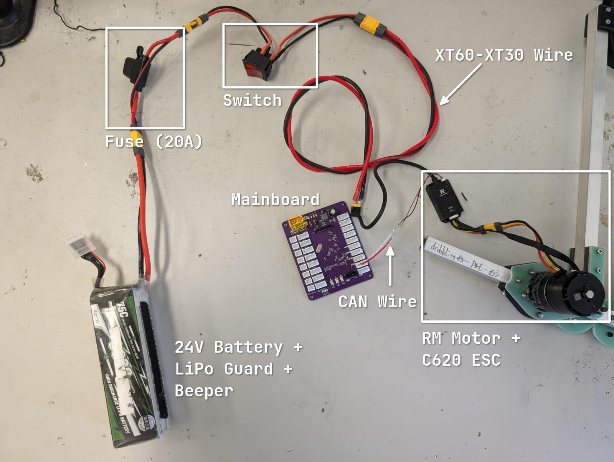

# Advance Tutorial 2: PID Control Theory and Motor Control

> **Author**: @adrianchong518
>
> 

>
> 
Acknowledgement

>
> These notes are based on the notes from previous iterations prepared by other senior members, including:
>
> - Li Ka Yau Elwin
> - Cecilia Lau
> - Dennis
> - Amber
> - Chalex
> - Brian
> - Starfall
>
> 

>
> AI has not been used in the preparation of these notes.

With motors and **math**, your software can finally do something more useful!

> [!IMPORTANT]
> Remember to _prepare and bring_ the required wires and components to your tutorial!
>
> 
>
> If you cannot get your Hardware members to prepare the wires, try ~stealing~ asking others nicely for their set.

## Chapters

1. [Control Theory 101](./01-control-theory.md)
1. [PID Control Theory](./02-pid-control.md)
1. [What even is CAN?](./03-can.md)
1. [Using the RM Motors](./04-rm-motor.md)
