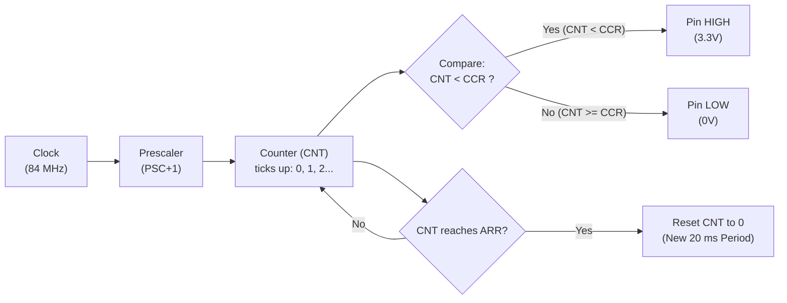
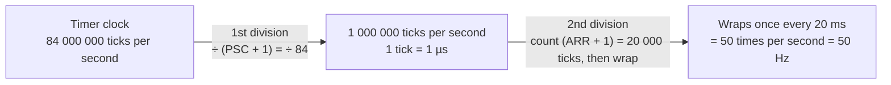
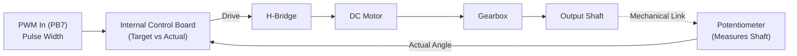

# 01 — PWM & Servo Theory

[Back to Index](README.md)

---

## 1. What is PWM?

**PWM (Pulse Width Modulation)** is a square wave that switches between **HIGH** (3.3V) and **LOW** (0V) at a fixed rate. We use it to control servo motors and motor speed.

```
       ◄────────────── Period (T) ──────────────►
       ┌──────────────────┐                     ┌──────────────────┐
3.3V   │                  │                     │                  │
       │                  │                     │                  │
0V   ──┘                  └─────────────────────┘                  └──
       ◄───── On-Time ────►◄───── Off-Time ─────►
             (t_on)              (t_off)
```

There are 4 terms you need to know:

- **Period ($T$):** Time for one full cycle (in seconds or ms).
- **Frequency ($f$):** How many cycles per second. $f = \frac{1}{T}$.
- **On-Time ($t_{on}$):** How long the pin stays HIGH in each cycle (in ms or µs).
- **Duty Cycle ($D$):** Percentage of time the signal is HIGH:
  $$D = \frac{t_{on}}{T} \times 100\%$$

---

## 2. How the STM32 Timer Makes PWM

The CPU does **not** sit in a loop waiting. A hardware timer counts automatically in the background.



Think of it like a runner on a track:

1. **Clock:** The clock runs at **84 MHz** on our STM32F405 main board.
2. **`PSC` (Prescaler):** Slows down the clock. We set it so each tick takes **exactly $1\,\mu\text{s}$**.
3. **`CNT` (Counter):** Ticks up: $0, 1, 2, 3 \dots$
4. **`ARR` (Auto-Reload):** The finish line. When `CNT` reaches `ARR`, it resets to 0. This sets the **Period (Frequency)**.
5. **`CCR` (Compare Register):** The threshold. The pin is **HIGH** while $CNT < CCR$, and drops **LOW** when $CNT \ge CCR$. This sets the **On-Time**.

### From 84 MHz to 50 Hz — You Divide Twice

First, clear up the wording, because this is where most people get lost:

| Term       | What it means                                                                  | Value here                  |
| :--------- | :----------------------------------------------------------------------------- | :-------------------------- |
| **84 MHz** | The **clock the chip runs on** — its heartbeat. Not a signal we send anywhere. | 84,000,000 ticks per second |
| **50 Hz**  | The **signal we want to output** on the pin.                                   | 1 pulse every 20 ms         |

We are **not copying 50 Hz out of 84 MHz** (much less "50 MHz"). We are **throwing away ticks** until what is left is slow enough: keep 1 tick, skip 83, keep 1, skip 83 … then stop and start over after 20,000 ticks.

The timer does that in **two divisions**, with two knobs:



| Stage        | Knob              | The question it answers   | Setting                   | What you get        |
| :----------- | :---------------- | :------------------------ | :------------------------ | :------------------ |
| 1st division | `PSC` = **83**    | How long is one tick?     | ÷ (83 + 1) = ÷ 84         | 1 tick = **1 µs**   |
| 2nd division | `ARR` = **19999** | How many ticks per pulse? | counts 19999 + 1 = 20 000 | 1 pulse = **20 ms** |

Now multiply the two divisions together:

$$
84 \times 20\,000 = 1\,680\,000
\qquad\Longrightarrow\qquad
\frac{84\,000\,000}{1\,680\,000} = \mathbf{50\,\text{Hz}}
$$

So the whole trick is: **divide 84 MHz by 1.68 million**, split into two easier pieces (÷84, then ÷20 000).

### Why Two Registers and Not One?

Because both `PSC` and `ARR` are **16-bit** — each can divide by at most 65,536.

- **One register alone:** best case ÷ 65,536 → $84\,000\,000 / 65\,536 \approx 1281\,\text{Hz}$. Not even close to 50 Hz.
- **Two together:** $65\,536 \times 65\,536 \approx 4.3$ billion → tons of room.

That is exactly why every STM32 timer gives you a prescaler **and** a period register.

### The Math Formulas (general form)

$$f_{tick} = \frac{f_{clk}}{PSC + 1}$$

$$f_{PWM} = \frac{f_{clk}}{(PSC + 1) \times (ARR + 1)}$$

$$t_{on} = CCR \times t_{tick}$$

> ⚠️ **Watch out (The Clock Trap):**  
> On the F405, APB1 bus clock is 42 MHz, but timers on APB1 run at **84 MHz** (the timer clock doubles when the bus divider is $>1$). Always use **84 MHz** in your calculations.

### The $1\,\mu\text{s}$ Tick Trick (Remember This!)

Step 1 above is deliberately chosen so that **1 tick = $1\,\mu\text{s}$**:

$$PSC = \frac{84\,000\,000}{1\,000\,000} - 1 = \mathbf{83}$$

Then 20 ms ($20\,000\,\mu\text{s}$) needs 20 000 ticks:

$$ARR = 20\,000 - 1 = \mathbf{19999}$$

**Why this is great:**  
Now **`CCR` is directly your pulse width in microseconds ($\mu\text{s}$)**!

- $CCR = 1000 \implies 1.0\,\text{ms}$ pulse
- $CCR = 1500 \implies 1.5\,\text{ms}$ pulse (neutral center)
- $CCR = 2000 \implies 2.0\,\text{ms}$ pulse

---

## 3. How a Servo Works & Why We Send PWM

### What's Inside the Servo?

An RC servo is a self-contained closed-loop actuator. Inside the plastic case:

1. **Small DC Motor:** Spins at high speed with low torque.
2. **Gearbox:** Slows down the speed and multiplies torque (~200×).
3. **Potentiometer (Sensor):** Mechanically locked to the output shaft to measure its physical angle.
4. **Internal Control Board:** Compares your commanded pulse width with the potentiometer voltage. If there is an error, it drives the motor forward or reverse until the error is zero!



### Why Send PWM Down There?

- **Noise Immunity:** An analog voltage (e.g. 0–3.3V) drops over jumper wires and picks up motor noise. A digital pulse width (time duration in $\mu\text{s}$) is immune to voltage drops.
- **Just 1 Signal Wire:** Standard 3-wire plug: Power (5V), Ground (GND), and **one Signal wire**. No clock lines or complex packet headers.
- **Offloads the STM32:** The servo handles position control **internally**. Your STM32 doesn't need to read an encoder or run a PID algorithm—you just set the pulse, and the servo drives itself there!

### Servo Specs & Safety

- **Frame Rate:** 50 Hz (one pulse every 20 ms).
- **Angle Range:** 0° to 180° (a limited-rotation servo, **not** continuous-rotation).
- **Center Position:** 1500 µs (1.5 ms) → 90°.
- **Safe Range:** 500 µs (0.5 ms) to 2500 µs (2.5 ms) (Xin Hui digital servo).
- **Pulse → Angle Map:** 500 µs → 0°, 1500 µs → 90°, 2500 µs → 180° (linear).

> ⚠️ **Why 50% Duty Cycle (10 ms) is Dangerous:**  
> Servos only understand pulses up to $2.5\,\text{ms}$. If you send 50% duty ($10\,\text{ms}$), the servo slams into its mechanical end-stop, pulls 2A+ stall current, overheats, and causes continuous brown-out resets on your STM32!

> **Commanded vs. Measured:**  
> The servo has no feedback wire returning to the STM32. The number on your TFT screen is the **commanded angle**, not a measured position.

## 4. Classwork 1: Student-ID Timing

Generate a **50 Hz PWM signal** using an **84 MHz timer clock**. Your target pulse width is determined by the last three digits of your **8-digit HKUST Student ID**:

$$
t_{\text{target}} = \left(1000 + \text{last 3 digits of your ID}\right)\,\mu\text{s}
$$

### Tasks

1. Find one valid prescaler and auto-reload pair \((PSC, ARR)\) [excluding the pair given] that produces exactly **50 Hz**. Both register values must be between **0 and 65535**.

2. Using your chosen pair, calculate the exact **\(CCR\)** value required to produce your target pulse width.

3. Calculate the resulting **duty cycle**:

   $D = \frac{CCR}{ARR + 1} \times 100\%$

4. Show your **Student ID**, **target pulse width**, **\(PSC\)**, **\(ARR\)**, **\(CCR\)**, and **duty cycle** to one of the seniors.

---

[Next: Timer Setup (.ioc) & Button Servo Code Demo →](02-buttons-tft.md)
