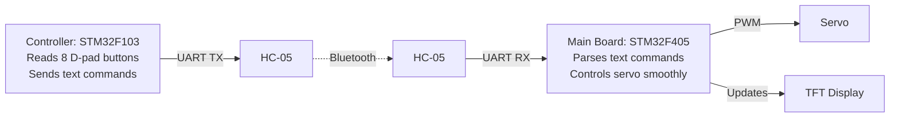

# 03 — Wireless Servo Control (Classwork 2)

[Back to Index](README.md)

---

## 1. System Overview

In this lab, you will build a wireless servo controller using two STM32 boards communicating over Bluetooth (HC-05 modules).



- **Controller (F103):** Reads button inputs from two D-pads and transmits newline-terminated text commands over UART.
- **Main Board (F405):** Receives the text commands, smoothly drives the servo to the requested position/speed, and displays the current status on the TFT screen.

---

## 2. Control & Protocol Specification

```
        LEFT D-PAD — "fixed" positions           RIGHT D-PAD — "+ / −"
              ┌──────┐                                    ┌──────┐
              │  60° │                                    │SPEED │
              │  (↑) │                                    │  UP  │
        ┌─────┼──────┼─────┐                        ┌─────┼──────┼─────┐
        │  0° │      │ 180°│                        │ CCW │      │  CW │
        │ (←) │      │ (→) │                        │ (←) │      │ (→) │
        └─────┼──────┼─────┘                        └─────┼──────┼─────┘
              │ 120° │                                    │SPEED │
              │  (↓) │                                    │ DOWN │
              └──────┘                                    └──────┘
```

### Command Table

Every command sent over UART **must end with a newline character (`\n`)**.

| Control         | Button        | Action           | Command String | Transmission Rule                                          |
| :-------------- | :------------ | :--------------- | :------------- | :--------------------------------------------------------- |
| **Left D-Pad**  | Left (←)      | Go to **0°**     | `SET:0\n`      | **Single-shot:** Send once per press (rising edge).        |
|                 | Up (↑)        | Go to **60°**    | `SET:60\n`     | **Single-shot:** Send once per press.                      |
|                 | Down (↓)      | Go to **120°**   | `SET:120\n`    | **Single-shot:** Send once per press.                      |
|                 | Right (→)     | Go to **180°**   | `SET:180\n`    | **Single-shot:** Send once per press.                      |
| **Right D-Pad** | Up (↑)        | Speed **+30°/s** | `SPEEDUP\n`    | **Single-shot:** Send once per press.                      |
|                 | Down (↓)      | Speed **−30°/s** | `SPEEDDOWN\n`  | **Single-shot:** Send once per press.                      |
|                 | Right (→)     | Rotate **CW**    | `CW\n`         | **Continuous:** Send every **100 ms** while held.          |
|                 | Left (←)      | Rotate **CCW**   | `CCW\n`        | **Continuous:** Send every **100 ms** while held.          |
|                 | _Release ←/→_ | Stop manual move | `STOP\n`       | **Single-shot:** Send once when `CW` or `CCW` is released. |

### System Rules (Both Boards)

1. **Smooth Motion Only:** Never jump directly to a target PWM pulse. Always ramp the servo angle toward the target at the current speed setting. _(The servo sweeps 0° to 180° only.)_
2. **Speed Clamping:** Clamp the speed on the Main Board to a safe range (e.g., **30°/s to 180°/s**).
3. **Link-Loss Watchdog (300 ms):** During manual rotation (`CW`/`CCW`), if the Main Board does not receive a new `CW` or `CCW` packet within **300 ms**, it must automatically stop the servo.
4. **Strict Parsing:** Any unrecognized or malformed command (e.g., `HELLO`, `SET:123`, `SET:200`) must be completely ignored.

---

## 3. Step-by-Step Implementation Guide

### Step 1: Hardware Mapping & Link Verification

1. **Map the Buttons:** Check the physical controller PCB for the printed button numbers (`SWx`). Open the `.ioc` file to match each button number to its corresponding GPIO Port and Pin.
2. **Verify UART/Bluetooth:** Using your code from Homework 2, pair the HC-05 modules. Send a test string (e.g., `"HELLO\n"`) from the Controller and display it on the Main Board's TFT screen before writing any servo logic.
3. **Implement tft_update():** Use the TFT to display the current commanded angle and speed. Update it every loop iteration (e.g., `tft_update(50)`).

### Step 2: Preset Positions (Left D-Pad)

1. **Controller:** Use edge detection (reuse `btn_read_rising_edge()` from [02-buttons-tft.md](02-buttons-tft.md)) so pressing a Left D-pad button sends its `SET:xxx\n` command **once**. Holding the button must not spam the UART.
2. **Main Board:** Parse the incoming `SET:xxx` lines. Set your target angle variable and smoothly increment/decrement the current servo angle toward the target at the active speed.

### Step 3: Manual Control & Speed (Right D-Pad)

1. **Controller:**
   - Send `SPEEDUP\n` and `SPEEDDOWN\n` once per press.
   - When `CW` or `CCW` is held down, use a timer/tick check to transmit `CW\n` or `CCW\n` once every **100 ms** (do not spam it on every `while(1)` loop pass).
   - On the falling edge (button release) of `CW` or `CCW`, send `STOP\n` once.
2. **Main Board:**
   - Adjust the movement speed variable when `SPEEDUP` or `SPEEDDOWN` arrives.
   - Continuously move the servo while `CW` or `CCW` is active, and halt immediately upon receiving `STOP`.
   - Implement the **300 ms watchdog timer**: record the timestamp of the last `CW`/`CCW` message, and stop manual motion if `current_time - last_msg_time > 300 ms`.

### Step 4: Harden the Receiver

- **Line Buffering:** Collect incoming UART bytes into a buffer until you see `\n`, then parse the complete line. Handle split packets and back-to-back commands gracefully.
- **Buffer Overflow Protection:** If an incoming line exceeds your buffer size without a `\n`, discard the buffer and reset it so garbage data cannot crash your parser.
- **Test Edge Cases:** Send invalid strings (`NOT_A_CMD`, `SET:123`) to verify nothing moves. Unplug the Controller mid-rotation to verify the Main Board stops within 300 ms.

---

## 4. Code Checklist

### Controller (STM32F103)

- [@] GPIO pin mapping completed for all 8 D-pad buttons.
- [@] UART helper function that sends a string terminated with `\n` over `huart1`.
- [@] Rising-edge detection for the 4 preset buttons (`SET:0`, `SET:60`, `SET:120`, `SET:180`) and 2 speed buttons (`SPEEDUP`, `SPEEDDOWN`).
- [@] 100 ms periodic transmitter for held `CW` / `CCW` buttons, plus falling-edge detection to send `STOP`.

### Main Board (STM32F405)

- [@] Non-blocking UART byte receiver that assembles complete `\n`-terminated lines safely.
- [@] Command parser that strictly matches valid commands and ignores everything else.
- [@] Non-blocking state machine tracking `current_angle`, `target_angle`, and `speed`.
- [@] 300 ms watchdog timeout for `CW`/`CCW` manual movement.
- [@] PWM timer update and live TFT display refresh (showing current angle and speed).

---

[Next: Troubleshooting & Final Demo Checklist →](04-troubleshooting.md)
